# Agent web UI

TahoePilot exposes LangGraph agents through a Next.js chat UI. The browser talks to CopilotKit, which streams [AG-UI](https://docs.ag-ui.com/) events from a FastAPI adapter (`agui_server.py`). This document explains how that pipeline works, which events matter, and how **Databot** and **Plan** share or diverge in the frontend.

**Audience:** contributors working on `frontend/`, `agui_server.py`, or agent graph state exposed to the UI.

**Related reading**

| Document | Contents |
|----------|----------|
| [`CHAT_OPTIMIZATION.md`](CHAT_OPTIMIZATION.md) | Product-level UI change log |
| [`agent/specialists/databot/README.md`](../agent/specialists/databot/README.md) | Databot graph stages and gate contract |
| [`agent/plan/nested_hitl.py`](../agent/plan/nested_hitl.py) | Plan nested specialist interrupts |

---

## Table of contents

1. [Overview](#overview)
2. [Architecture](#architecture)
3. [Concepts](#concepts)
4. [Event reference](#event-reference)
5. [Agent pages](#agent-pages)
6. [Human-in-the-loop (gates)](#human-in-the-loop-gates)
7. [Secondary APIs](#secondary-apis)
8. [Guides](#guides)
9. [Troubleshooting](#troubleshooting)
10. [Source index](#source-index)

---

## Overview

Two agents have dedicated UI today:

| Agent ID | Route | Purpose |
|----------|-------|---------|
| `databot` | `/` | Staged data retrieval: RAG → human-gated SQL → execute |
| `plan` | `/plan` | Decompose a task, delegate to specialists, summarize |

Both use the same transport (AG-UI over Server-Sent Events) and the same CopilotKit hooks. They differ in **working panels** (artifact tabs vs. plan tree) and **gate presentation** (right-column dock vs. full-screen modal).

**Design goals**

- Stream graph progress to the chat without a custom WebSocket protocol.
- Keep checkpoint state authoritative (`checkpoints.sqlite` on the backend).
- Hide orchestration prose and model reasoning from end users; show tool cards, gates, and final answers.
- Register tool names on the frontend so CopilotKit renders in-chat cards instead of dev-only inspector links.

---

## Architecture

### System context

*Figure 1 — End-to-end request path from browser to LangGraph.*

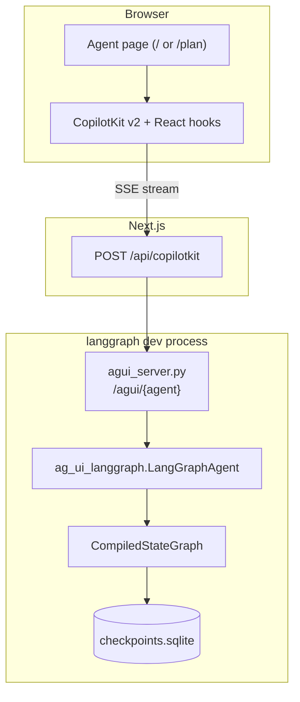

| Layer | Role |
|-------|------|
| React pages | Layout, chat shell, agent-specific panels |
| CopilotKit + `@ag-ui/client` | Consume SSE; hold in-memory `agent` (messages, state, interrupts) |
| `agui_server.py` | One POST handler per agent; encode AG-UI events |
| `LangGraphAgent` | Map LangGraph `astream_events` → `ag_ui.core.EventType` |
| Checkpoint DB | Persistent messages and graph state |

> **Note:** CopilotKit’s `InMemoryAgentRunner` stores thread metadata only. Conversation history lives in the LangGraph checkpointer.

### Agent registration

The string `agentId` must match everywhere it appears:

*Figure 2 — `agentId` coupling between frontend and backend.*

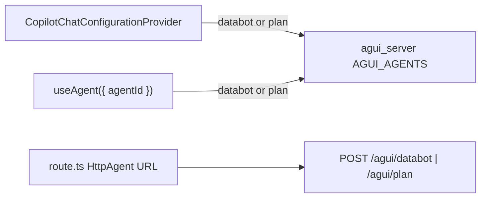

| `agentId` | Backend path | Python entry | Frontend page |
|-----------|--------------|--------------|---------------|
| `databot` | `/agui/databot` | `DatabotAgent` | `frontend/app/page.tsx` |
| `plan` | `/agui/plan` | `PlanAgent` | `frontend/app/plan/page.tsx` |

Registration sites: `agui_server.py` (`AGUI_AGENTS`) and `frontend/app/api/copilotkit/[...path]/route.ts`.

### Run lifecycle

*Figure 3 — One user turn from submit to completion or interrupt.*

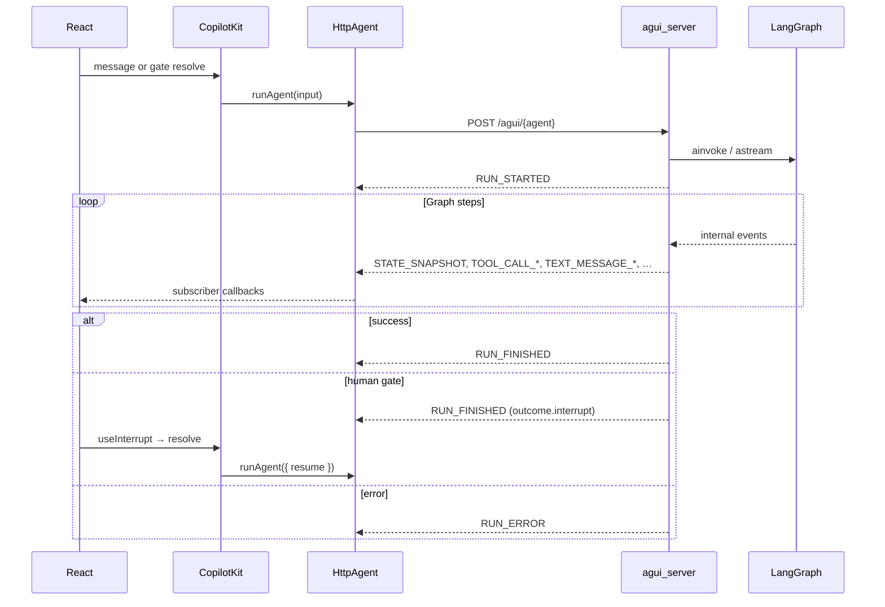

*Figure 4 — Client-side run state.*

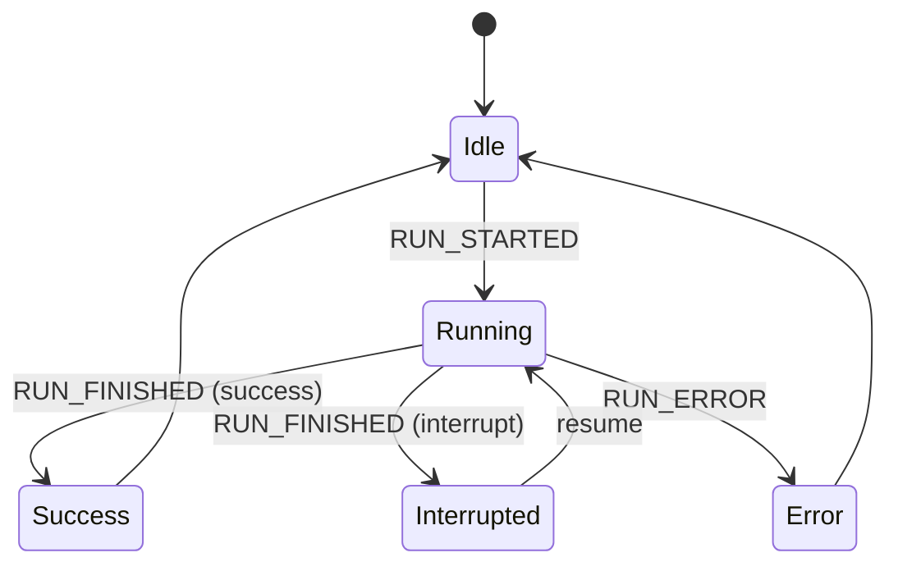

### In-memory `agent` object

`@ag-ui/client` updates a single `agent` instance per thread. Field writes do **not** trigger React re-renders; components subscribe via CopilotKit hooks or `agent.subscribe()`.

*Figure 5 — How AG-UI events populate `agent` and which UI reads them.*

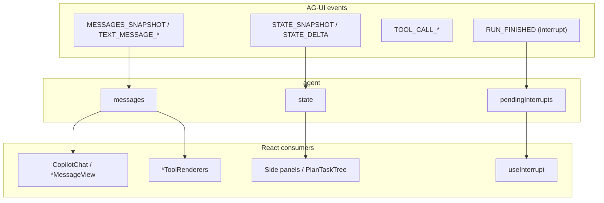

| Field | Typical source events | Primary consumers |
|-------|----------------------|-------------------|
| `messages` | `MESSAGES_SNAPSHOT`, `TEXT_MESSAGE_*`, tool assembly | Chat, tool cards |
| `state` | `STATE_SNAPSHOT`, `STATE_DELTA` | Working panels, gate banners |
| `pendingInterrupts` | `RUN_FINISHED` with `outcome.type === "interrupt"` | `useInterrupt` |
| `isRunning` | `RUN_STARTED`, `RUN_FINISHED`, `RUN_ERROR` | Input disable, debug panel |

---

## Concepts

| Term | Definition |
|------|------------|
| **AG-UI event** | Typed message on the SSE stream (`ag_ui.core.EventType`), e.g. `TOOL_CALL_START`. |
| **Path B** | Wiring where Next.js proxies directly to `agui_server`’s `LangGraphAgent`, not a generic LangGraph deployment bridge. |
| **`agentId`** | Logical agent name; keys the HttpAgent URL and CopilotKit agent registry. |
| **`STATE_SNAPSHOT`** | Full (filtered) graph state pushed to the client after steps. |
| **`MESSAGES_SNAPSHOT`** | Full chat transcript synced from the checkpoint. |
| **Interrupt / HITL** | LangGraph pause via `interrupt()`; surfaced as `RUN_FINISHED.outcome.interrupts`. |
| **Gate payload** | JSON in interrupt `message` (`gates.py`); shared by Databot dock and Plan modal. |
| **`persist_plain_text=False`** | ReAct subgraph omits orchestration plain text from checkpoint history. |
| **Tool renderer** | `useRenderTool({ name, render })` registration; required for in-chat tool cards. |

---

## Event reference

Events are grouped by how TahoePilot uses them. Full enum: `ag_ui.core.EventType`.

### Event families

*Figure 6 — AG-UI event taxonomy in this project.*

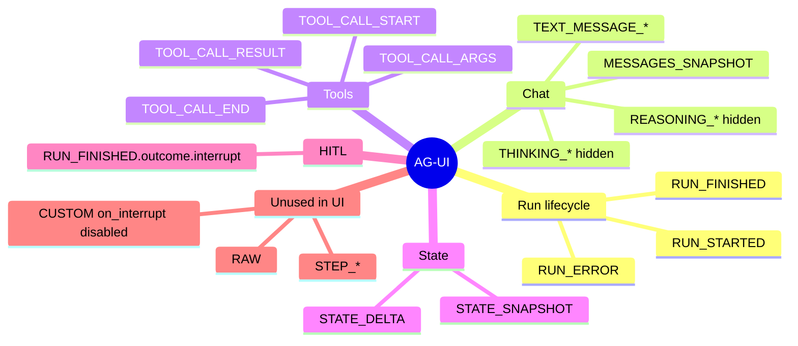

### Shared events (all agents)

These behave the same for Databot and Plan.

#### Run lifecycle

| Event | Emitted when | Client handling | Shown to user |
|-------|--------------|-----------------|---------------|
| `RUN_STARTED` | Run begins | `isRunning = true` | No |
| `RUN_FINISHED` | Run ends | `isRunning = false`; may set `pendingInterrupts` | Gate UI if interrupt |
| `RUN_ERROR` | Failure or broken stream | Error state in chat | Yes |

#### Chat messages

| Event | Emitted when | Client handling | Shown to user |
|-------|--------------|-----------------|---------------|
| `TEXT_MESSAGE_*` | LLM streams tokens | Appended to `agent.messages` | After `DatabotAssistantMessage` filter |
| `MESSAGES_SNAPSHOT` | Batch sync from checkpoint | Replaces/merges `messages` | After filter |
| `REASONING_*`, `THINKING_*` | Provider reasoning channels | Same pipeline | **Hidden** (`reasoningMessage={() => null}`) |

*Figure 7 — Chat visibility policy.*

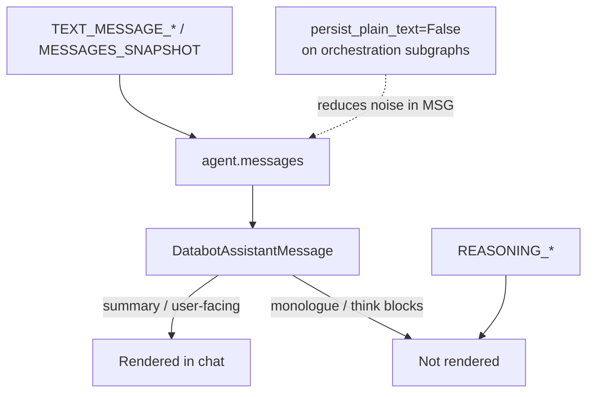

**Policy:** ReAct orchestration loops use `persist_plain_text=False`. User-visible prose is produced by explicit summary paths (Databot turn summary / `chat_completion`; Plan `NODE_SUMMARY`).

#### Tool calls

| Event | Role |
|-------|------|
| `TOOL_CALL_START` | Open tool card; match `useRenderTool` by name |
| `TOOL_CALL_ARGS` | Stream arguments into card |
| `TOOL_CALL_END` | LLM-side tool call complete |
| `TOOL_CALL_RESULT` | Attach `ToolMessage` result to card |

*Figure 8 — Tool call rendering.*

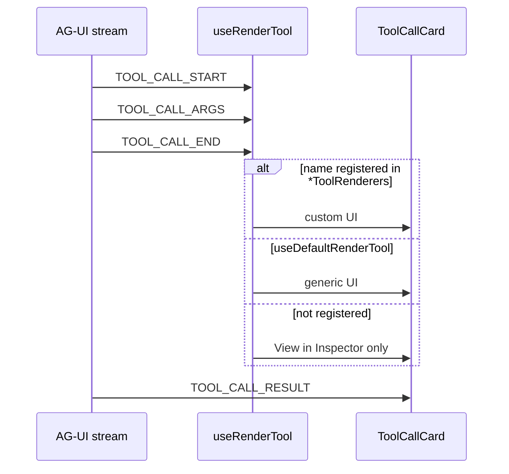

#### Graph state

| Event | Role |
|-------|------|
| `STATE_SNAPSHOT` | Replace `agent.state` with schema-filtered snapshot |
| `STATE_DELTA` | JSON patch merge (when emitted) |

*Figure 9 — State snapshot path.*

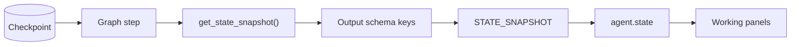

**State contracts** (documented subsets; must align with graph output schema):

| Agent | Python | TypeScript |
|-------|--------|------------|
| Databot | `DATABOT_STATE_KEYS` in `ui_actions.py` | `DatabotAgentState` in `types.ts` |
| Plan | `PLAN_STATE_KEYS` in `plan/ui_state.py` | `PlanAgentState` in `planTypes.ts` |

> **Important:** Keys absent from the compiled graph’s output schema are stripped before `STATE_SNAPSHOT` is sent. Check `get_schema_keys` logs in `agui_server.py` when a field is missing in the UI.

#### Human-in-the-loop (interrupt bundle)

Interrupts are **not** a separate top-level event. They arrive on `RUN_FINISHED`:

```json
{
  "type": "RUN_FINISHED",
  "outcome": {
    "type": "interrupt",
    "interrupts": [
      {
        "id": "databot-cards-gate",
        "reason": "Review 2 model(s)…",
        "message": "{\"gate\":\"cards\",\"question\":\"…\",\"options\":[…]}"
      }
    ]
  }
}
```

Backend adapter flags in `agui_server.py` (both agents):

| Flag | Value | Why |
|------|-------|-----|
| `emit_interrupt_outcome` | `true` | CopilotKit v2 reads `outcome.interrupts` |
| `enable_legacy_on_interrupt_event` | `false` | Avoids v1 `CUSTOM on_interrupt` freeze |

Resume path: `useInterrupt` → `resolve(payload)` → `runAgent({ resume })` → LangGraph `Command(resume=…)`.

Gate JSON schema: `agent/specialists/databot/gates.py`. Parser: `parseGateInterruptMessage` in `databotGateUtils.ts`.

### Agent-specific event usage

| Concern | Databot | Plan |
|---------|---------|------|
| Gate UI trigger | `useInterrupt` + `state.stage` for banner | `useInterrupt` + `pendingInterrupts` for banner |
| `STATE_SNAPSHOT` consumers | Cards, SQL, results tabs; `stage` | `plan_snapshot`, `step_results`, `stage` |
| Custom tool renderers | Pipeline + DataHub tools | `create_plan`, `planning`, `invoke_agent` |
| Non-SSE state writes | `POST /api/databot/actions` | — |

---

## Agent pages

### Shared layout

Both pages use a three-region layout: chat (left), invisible tool-renderer mount (center), working panel (right).

*Figure 10 — Shared vs agent-specific components.*

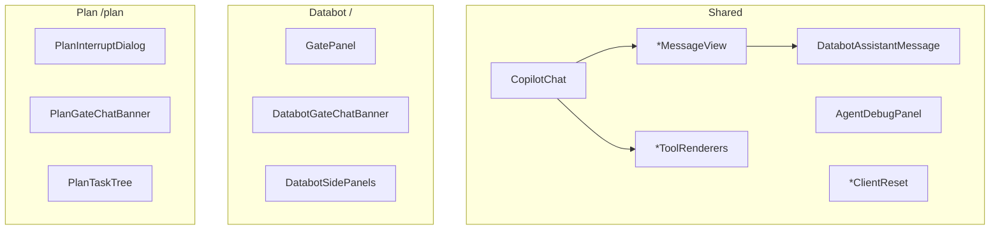

| Component | Shared | Responsibility |
|-----------|--------|----------------|
| `*MessageView` | Pattern | Chat list shell; hides reasoning rows |
| `DatabotAssistantMessage` | Yes | Filter monologue and think blocks |
| `*ToolRenderers` | Per agent | Register `useRenderTool` handlers |
| `useAgentRefresh` | Yes | Re-render when `agent` mutates in place |
| `AgentDebugPanel` | Yes | Read-only: messages, state, interrupts |
| `*ClientReset` | Per agent | Clear `agent` on new thread |

### Databot (`/`)

*Figure 11 — Databot page regions.*

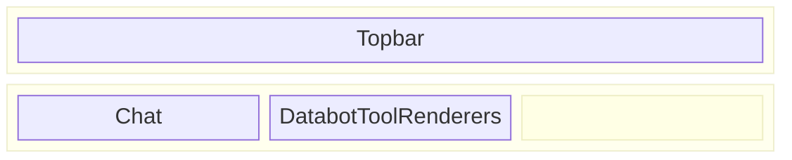

| Component | Data source |
|-----------|-------------|
| `GatePanel` | `useInterrupt`; live `review_cards` / `draft_sql` from `state` |
| `DatabotGateChatBanner` | `state.stage` ∈ `{ gate_cards, gate_sql }` |
| `DatabotSidePanels` | `STATE_SNAPSHOT` artifact fields |
| `useDatabotActions` | REST patch (see [Secondary APIs](#secondary-apis)) |

### Plan (`/plan`)

*Figure 12 — Plan page regions (modal overlays chat).*

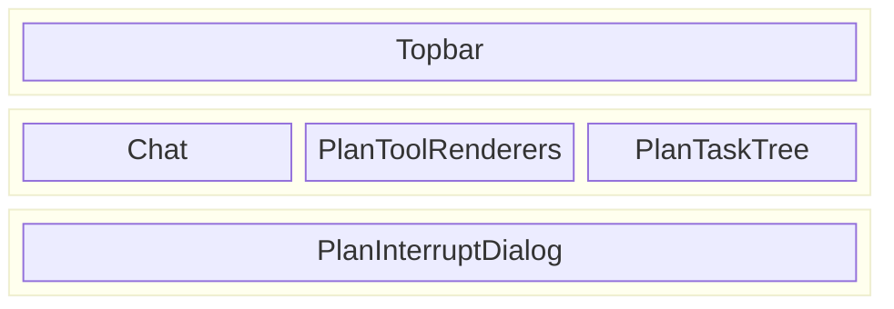

| Component | Data source |
|-----------|-------------|
| `PlanInterruptDialog` | `useInterrupt({ agentId: "plan" })` |
| `PlanGateChatBanner` | `pendingInterrupts[0]` → gate kind |
| `PlanTaskTree` | `plan_snapshot`, `step_results`, `stage` |

---

## Human-in-the-loop (gates)

### Databot — docked gate

The graph calls `interrupt()` in gate nodes. The right column renders options via `GatePanel` (`renderInChat: false`).

### Plan — modal gate (nested specialist)

When Plan delegates via `invoke_agent`, a child specialist (e.g. Databot) may hit a gate. `nested_hitl.py` re-emits the interrupt on the **Plan** graph so the Plan SSE stream carries the same payload.

*Figure 13 — Nested HITL sequence.*

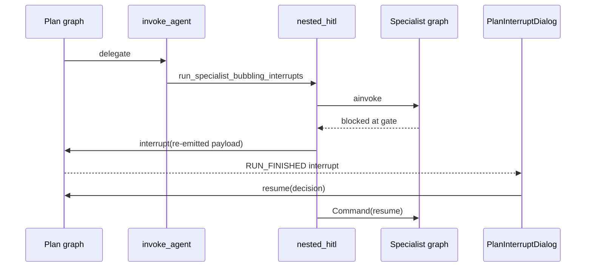

> **Important:** `GraphInterrupt` must propagate out of `StepActionNode`. `graph/error_recovery.py` re-raises LangGraph control-flow exceptions instead of converting them to tool error messages.

*Figure 14 — Interrupt pipeline (both agents).*

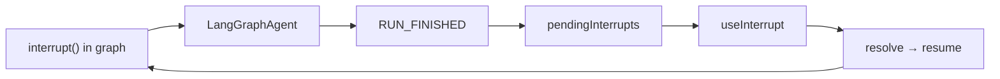

---

## Secondary APIs

Primary transport is AG-UI SSE. Databot additionally exposes a REST endpoint for artifact edits without an LLM turn.

*Figure 15 — SSE vs REST.*

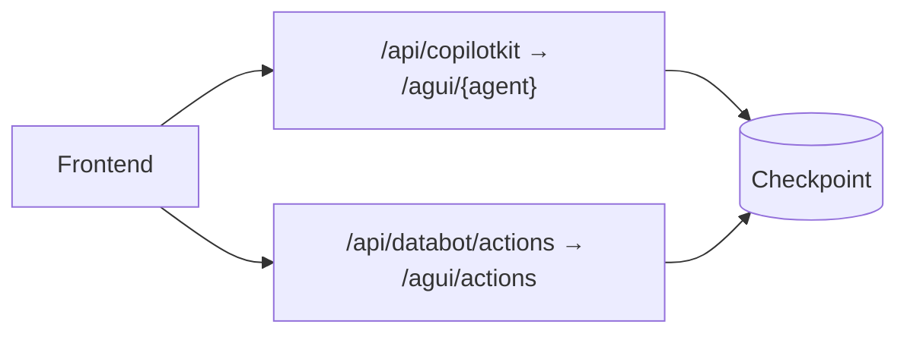

| Endpoint | Agents | Purpose |
|----------|--------|---------|
| `POST /api/copilotkit/*` | All | User messages, interrupt resume |
| `POST /api/databot/actions` | Databot only | Patch card selection or SQL draft in checkpoint |

REST responses include an updated `state` object; the client merges it with `agent.setState()`.

---

## Guides

### Add a new agent page

1. Register the graph in `agui_server.py` (`AGUI_AGENTS`) and `frontend/app/api/copilotkit/[...path]/route.ts` (`HttpAgent`).
2. Create a page with `CopilotChatConfigurationProvider agentId="…"`.
3. Add `*MessageView` (reuse `DatabotAssistantMessage` for prose filtering).
4. Add `*ToolRenderers` with `useDefaultRenderTool()` plus handlers for each tool name the agent emits.
5. Add a working panel that reads `agent.state` via `useAgent` + `useAgentRefresh`.
6. Define `*_STATE_KEYS` (Python) and a TypeScript state interface; ensure keys are in the graph output schema.
7. Set `persist_plain_text=False` on orchestration ReAct subgraphs; add one explicit summary node for user-facing text.
8. If the agent uses human gates: call `interrupt({ id, reason, message })`, mount `useInterrupt`, and keep adapter interrupt flags enabled.

*Figure 16 — New agent checklist.*

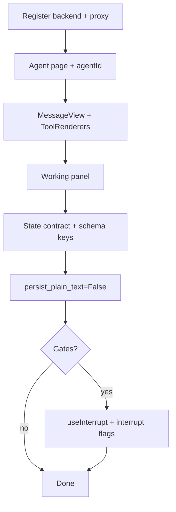

### Register a tool card

```tsx
// In *ToolRenderers.tsx
useRenderTool({
  name: "my_tool",
  parameters: z.object({ query: z.string().optional() }),
  render: ({ status, parameters, result }) => (
    <ToolCallCard title="My tool" status={status} … />
  ),
});
```

Call `useDefaultRenderTool()` once in the same component so unlisted tools still get a generic card.

### Debug a missing UI update

1. Enable **Debug** in the topbar → inspect `AgentDebugPanel`.
2. Confirm `STATE_SNAPSHOT` includes the expected keys (`tools` count, interrupt count).
3. If tool calls show “View in Inspector”, add a `useRenderTool` entry for that name.
4. If gate UI never opens, verify `pendingInterrupts` after run ends and adapter flags in `agui_server.py`.

---

## Troubleshooting

| Symptom | Likely cause | What to check |
|---------|--------------|---------------|
| “View in Inspector (local only)” | Tool name not registered | `*ToolRenderers.tsx`, `useDefaultRenderTool` |
| Gate never appears | Interrupt swallowed as tool error | `error_recovery.py` re-raises `GraphInterrupt` |
| Gate never appears | Legacy interrupt channel only | `emit_interrupt_outcome=True` in `agui_server.py` |
| State field always empty | Key not in output schema | `get_schema_keys` log; graph state class |
| Orchestration text in chat | Plain text persisted or not filtered | `persist_plain_text`; `DatabotAssistantMessage` |
| Plan gate on Databot page / vice versa | Wrong `agentId` on `useInterrupt` | `GatePanel` vs `PlanInterruptDialog` |
| Chat frozen after gate | Resume not sent | `useInterrupt` `resolve` → `runAgent({ resume })` |
| Plan Action-required banner, no dialog, tools still Running | Stale `pendingInterrupts` after cards resume; SQL modal waits for `RUN_FINISHED` | Banner ignores pending gates while `agent.isRunning`; dialog picks sql/cards from the interrupt list (skips nested HITL replay) |
| Stop run opens draft-SQL dialog | Abort sets `isRunning` false without clearing `pendingInterrupts` | `usePlanStopDismissal` drops leftover gates on abort |
| New chat shows old artifacts | Client state not cleared | `reset*AgentView` in New chat handler |

---

## Source index

| Topic | Location |
|-------|----------|
| AG-UI HTTP server | `agui_server.py` |
| LangGraph → AG-UI adapter | `ag_ui_langgraph.LangGraphAgent` |
| Next.js proxy | `frontend/app/api/copilotkit/[...path]/route.ts` |
| Root CopilotKit provider | `frontend/app/providers.tsx` |
| Databot page | `frontend/app/page.tsx` |
| Plan page | `frontend/app/plan/page.tsx` |
| Message filtering | `frontend/app/components/DatabotAssistantMessage.tsx` |
| Gate payload (backend) | `agent/specialists/databot/gates.py` |
| Plan nested HITL | `agent/plan/nested_hitl.py` |
| Databot state contract | `agent/specialists/databot/ui_actions.py` |
| Plan state contract | `agent/plan/ui_state.py` |
| Databot REST actions | `frontend/app/api/databot/actions/route.ts` |

*Figure 17 — Repository map.*

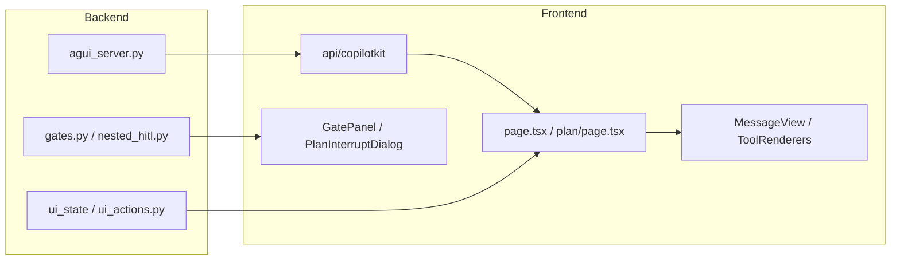
