# Plan agent web UI

Plan agent 是 TahoePilot 的多步编排入口:把一个用户请求拆成有序步骤、委派给 specialist、最后给一份合并回复。本文档解释浏览器、CopilotKit、AG-UI、`agui_server.py`、LangGraph 之间的端到端连线,Plan 与 Databot 在前端共享 / 分歧的部分,以及当前实现的可用性 bug 与代码质量问题。

**受众** 改 `agent/plan/*` / `frontend/app/plan/*` / `agui_server.py` 的人。
**基线版本** 2026-09-07 working tree。
**关联阅读**

| 文档 | 内容 |
|------|------|
| [`FRONTEND_AGENTS_UI.md`](FRONTEND_AGENTS_UI.md) | Databot + Plan 的整体架构(本文是 Plan 的纵向深入) |
| [`CHAT_OPTIMIZATION.md`](CHAT_OPTIMIZATION.md) | 优化日志 |
| [`agent/plan/README.md`](../agent/plan/plan_agent.py) | Plan 后端入口 |
| [`agent/plan/nested_hitl.py`](../agent/plan/nested_hitl.py) | Plan 嵌套 specialist 的 interrupt 处理 |
| [`CODE_REVIEW.md`](CODE_REVIEW.md) / [`DATABOT_REVIEW.md`](DATABOT_REVIEW.md) | 历史 review |

---

## 目录

1. [Overview](#1-overview)
2. [Architecture](#2-architecture)
3. [Concepts](#3-concepts)
4. [Event reference](#4-event-reference)
5. [Plan agent page](#5-plan-agent-page)
6. [Human-in-the-loop (gates)](#6-human-in-the-loop-gates)
7. [Secondary APIs](#7-secondary-apis)
8. [Guides](#8-guides)
9. [Bug catalog(几乎不可用的根因)](#9-bug-catalog几乎不可用的根因)
10. [Code quality & extensibility](#10-code-quality--extensibility)
11. [Troubleshooting & recommended fixes](#11-troubleshooting--recommended-fixes)
12. [Source index](#12-source-index)

---

## 1. Overview

### 1.1 是什么

Plan agent 的 Web UI 是一个 Next.js 路由 `/plan`,用户在此:

1. 提一个多步任务(例如"对比 US / EU 过去 8 周 GMV 并写个总结")
2. Plan 后端(LangGraph)拆出 3-5 步,逐步委派给 `databot` / `knowledge` / `swe` / `diagnostic` / `data_analysis` specialist
3. 用户在跑的过程中可以**看到右侧 task tree 的实时进度**
4. 如果某个委派的 specialist 触发了 human gate(例如 databot 的 SQL review),会以**全屏 modal** 形式让用户决定
5. 全部完成后,Plan 给出合并回复

| Agent ID | 路由 | 用途 |
|----------|------|------|
| `plan` | `/plan` | 拆解任务 + 委派 specialist + 合并回复 |

### 1.2 设计目标

* 流式把图进度推到 chat,无需自定义 WebSocket 协议
* checkpoint 状态是权威(`checkpoints.sqlite` 在后端)
* 隐藏 orchestrator 内部的 ReAct monologue 和 model reasoning,只给 user 看 tool card / gate / 最终回复
* 工具名在前端注册,让 CopilotKit 渲染 in-chat 卡片而不是 dev-only inspector
* 嵌套 specialist 的 human gate 沿 Plan 的 SSE 流上行,在同一个 chat 里就能决策

### 1.3 与 Databot 的差异(高层)

| 关注点 | Databot | Plan |
|--------|---------|------|
| 工作面板 | Cards / SQL / Results 三个 tab | 单个 task tree(标题 + 进度条 + 步骤列表) |
| Human gate | 右侧 dock(`renderInChat: false`,inline 在右列) | 全屏 modal(backdrop blur) |
| 嵌套 HITL | — | Plan → Databot 的 SQL gate 沿 Plan SSE 上行 |
| Subgraph 数 | 单图 | 外层 + 3 个 ReAct subgraph(create / execute / adjust)+ summary |
| 状态后端契约 | `DATABOT_STATE_KEYS` | `PLAN_STATE_KEYS` |
| 工具渲染器 | Pipeline + DataHub 工具 | `create_plan` / `planning` / `invoke_agent` |
| 直写 checkpoint 的 REST | `POST /api/databot/actions` | — |

---

## 2. Architecture

### 2.1 System context

*Figure 1 — End-to-end request path from browser to LangGraph.*

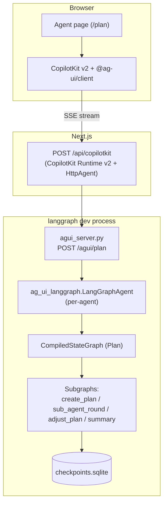

| Layer | Role |
|-------|------|
| React pages | Layout, chat shell, plan-specific task tree |
| CopilotKit + `@ag-ui/client` | 消费 SSE,持有 in-memory `agent`(messages / state / interrupts) |
| Next.js Route | 把 SSE 透传到 agui_server,可选做认证 / 限流 |
| `agui_server.py` | 一个 POST handler per agent;`EventEncoder` 编码 AG-UI 事件 |
| `LangGraphAgent` | 把 LangGraph `astream_events` 映射成 `ag_ui.core.EventType` |
| Checkpoint DB | 持久化 messages + graph state(权威源) |

> **Note:** CopilotKit 的 `InMemoryAgentRunner` 只存 thread metadata,真正的对话历史在 LangGraph checkpointer 里。`/api/copilotkit/...` 即使重启,thread 也会自动重连上正确的 checkpoint。

### 2.2 Plan 后端模块结构

*Figure 2 — `agent/plan/*` 模块依赖.*

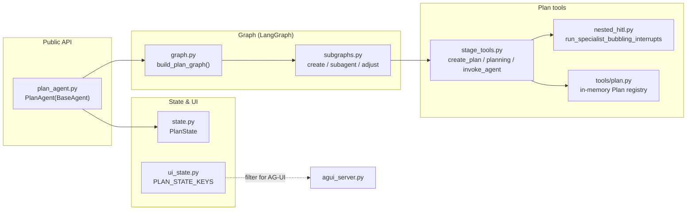

| 模块 | 责任 |
|------|------|
| `plan_agent.py` | `PlanAgent` 入口(继承 `BaseAgent`),管 `bind()` / `run()` / 准备 turn input |
| `graph.py` | 外层图(START → inject → create → execute → adjust → summary → END) |
| `subgraphs.py` | 每个阶段一个 ReAct subgraph;`_stage_state_exit_router` 决定退出口 |
| `stage_tools.py` | Plan 自己的三个工具 + `SpecialistRunner` |
| `nested_hitl.py` | 嵌套 specialist 的 interrupt 上行 + replay 计数 |
| `tools/plan.py` | `Plan` / `StepStatus` / `run_planning` + LangChain `@tool` 包装,被 databot / knowledge 等 specialist 也引用 |
| `state.py` | `PlanState` TypedDict(继承 `SessionAgentState`) |
| `ui_state.py` | `PLAN_STATE_KEYS`,只读子集给前端 |

### 2.3 Agent registration: agentId 的 4 处硬编码

*Figure 3 — `agentId` coupling between frontend and backend.*

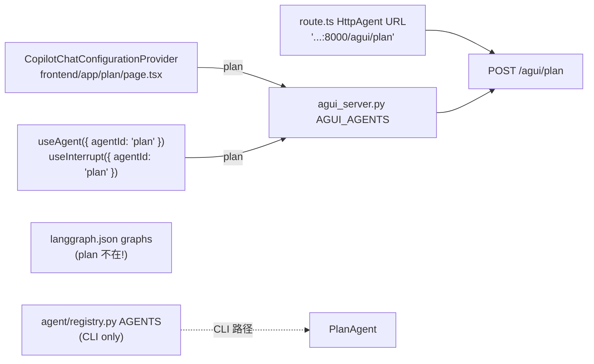

| `agentId` | 后端路径 | Python entry | 前端 page | 同步点 |
|-----------|----------|--------------|-----------|--------|
| `plan` | `/agui/plan` | `PlanAgent` | `frontend/app/plan/page.tsx` | 4 处见下表 |

**4 处硬编码点(必须同步改):**

| 文件 | 改什么 |
|------|--------|
| `frontend/app/api/copilotkit/[...path]/route.ts:33-53` | `agents: { plan: new HttpAgent(...) }` |
| `agui_server.py:91-94` | `AGUI_AGENTS = { "plan": "..." }` |
| `langgraph.json:3-7` | `graphs: { "plan": "..." }`(目前**漏掉**了 plan) |
| `agent/registry.py:148-156` | `AGENTS` 字典 |

文档 `FRONTEND_AGENTS_UI.md:573-595` 已经画过 checklist,说明这事已经发生过多次 — 加新 agent 时容易漏。

### 2.4 Plan 图的运行时结构

*Figure 4 — Outer plan graph + 3 subgraphs + summary.*

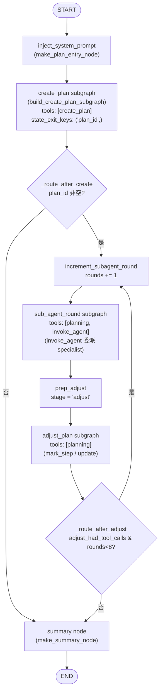

| Node / 边 | 行为 | 代码位置 |
|-----------|------|----------|
| `inject_system_prompt` | 注入 plan system prompt;如果是新 turn(`stage=done` 且有 user_question)就 reset 状态字段 | `graph.py:119-135` |
| `create_plan` | ReAct 单轮 subgraph,LLM 必须调 `create_plan` 后退出 | `subgraphs.py:58-83` |
| `_route_after_create` | 看 `state.plan_id` 是否被 set,空 → 直接 summary;非空 → 进入执行 | `graph.py:62-65` |
| `increment_subagent_round` | `subagent_rounds += 1` | `graph.py:47-52` |
| `sub_agent_round` | ReAct subgraph,工具是 `planning` + `invoke_agent` | `subgraphs.py:86-118` |
| `prep_adjust` | 设 `stage=adjust`,清 `adjust_had_tool_calls` | `graph.py:55-59` |
| `adjust_plan` | ReAct subgraph,只允许 `planning` 工具(改 step 状态) | `subgraphs.py:121-145` |
| `_route_after_adjust` | 如果 adjust 阶段产生了 tool calls 且没超 8 轮,继续执行;否则 summarize | `graph.py:68-72` |
| `summary` | 用 LLM 把 step_results 合成 user-facing 回复 | `graph.py:85-116` |

### 2.5 嵌套 specialist 的执行路径

*Figure 5 — How Plan delegates to a specialist (e.g. Databot SQL gate).*

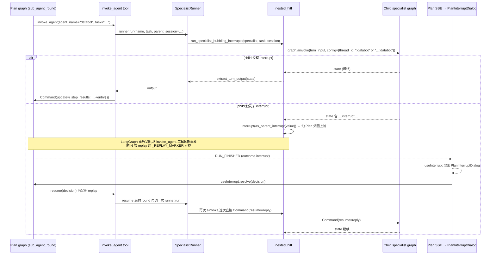

**两个关键点:**

1. **child thread id 的来源**: `SpecialistRunner.run` 从 `state.get("session_name")` 取 parent,然后 `specialist_session_id(parent, name)` 产 `{parent}:{name}`。**问题**: AG-UI 路径不会调 `PlanAgent.prepare_turn_input`,所以 `state.session_name` 永远是空 → child thread id 变成 `:databot`(全局共享,详见 §9 Bug-1)。

2. **`_REPLAY_MARKER` replay 计数**: LangGraph 在 resume 时从父图工具顶端重放。`nested_hitl._applied_by_session[session]` 记录这个 child session 已经 replay 了多少次 `interrupt()` 调用,重放时主动调 `interrupt(_REPLAY_MARKER)` 消耗掉,这样 user 看到的 `RUN_FINISHED.outcome.interrupts[0]` 始终是真正的 gate,不是 replay 占位。前端用 `isPlanReplayInterrupt(id === "plan-nested-hitl-replay")` 过滤。

### 2.6 In-memory `agent` object 流向

*Figure 6 — How AG-UI events populate `agent` and which Plan UI reads them.*

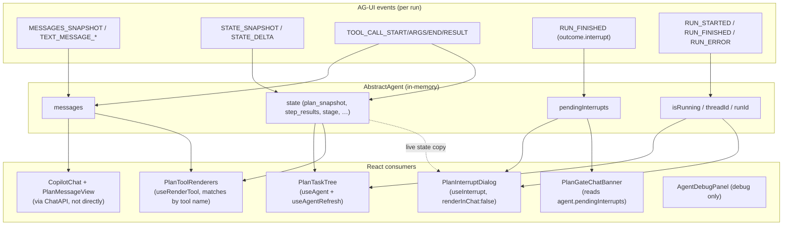

| Field | Source events | Primary Plan consumers |
|-------|--------------|------------------------|
| `messages` | `MESSAGES_SNAPSHOT`, `TEXT_MESSAGE_*`, tool assembly | `CopilotChat` + `PlanMessageView` |
| `state` | `STATE_SNAPSHOT`, `STATE_DELTA` | `PlanTaskTree` (snapshot/steps), `PlanGateChatBanner` (stage), `PlanInterruptDialog` (via `useInterrupt`) |
| `pendingInterrupts` | `RUN_FINISHED` with `outcome.type === "interrupt"` | `PlanGateChatBanner` (有问题,见 §9 Bug-2) |
| `isRunning` / `threadId` / `runId` | `RUN_STARTED`, `RUN_FINISHED`, `RUN_ERROR` | `PlanNewChatButton` (busy), `PlanInterruptDialog`, debug panel |

### 2.7 Plan vs Databot:前端组件对照

*Figure 7 — Plan-only vs shared components.*

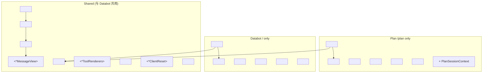

| 组件 | 类型 | 职责 |
|------|------|------|
| `*MessageView` | 模式 | chat list 壳;隐藏 reasoning 行 |
| `DatabotAssistantMessage` | 共享 | 过滤 monologue / think blocks(Plan 复用) |
| `*ToolRenderers` | per-agent | 注册 `useRenderTool` handlers |
| `useAgentRefresh` | 共享 | 当 `agent` 原地 mutate 时强制 re-render |
| `AgentDebugPanel` | 共享 | 只读:messages / state / interrupts |
| `*ClientReset` | per-agent | `startNewThread()` 后清 `agent` |
| `PlanGateChatBanner` | Plan only | chat 里的小提示,提醒去 dialog 决策 |
| `PlanTaskTree` | Plan only | 右栏 task tree,核心面板 |
| `PlanInterruptDialog` | Plan only | 全屏 modal,渲染 gate UI |
| `usePlanStopDismissal` | Plan only | 跟踪 stop / fail,避免 stale `pendingInterrupts` |

---

## 3. Concepts

| 术语 | 定义 |
|------|------|
| **AG-UI event** | SSE 流上的 typed 消息(`ag_ui.core.EventType`),如 `TOOL_CALL_START` |
| **Path B** | 接入方式:Next.js 直连 `agui_server.LangGraphAgent`,不经过通用 LangGraph deployment 桥 |
| **`agentId`** | 逻辑 agent 名;key 着 HttpAgent URL 和 CopilotKit agent registry |
| **`STATE_SNAPSHOT`** | 全量(经 schema 过滤的)graph state,在每个 step 之后推到客户端 |
| **`STATE_DELTA`** | JSON patch 增量(部分事件) |
| **`MESSAGES_SNAPSHOT`** | 从 checkpoint 同步的完整 chat transcript |
| **Interrupt / HITL** | LangGraph `interrupt()` 暂停;被序列化成 `RUN_FINISHED.outcome.interrupts` |
| **Gate payload** | interrupt `message` 字段里的 JSON(`gates.py` 的 schema);Databot dock 和 Plan modal 共用 |
| **`persist_plain_text=False`** | ReAct subgraph 不把 orchestrator 内部 plain text 写进 checkpoint |
| **Tool renderer** | `useRenderTool({ name, render })` 注册;为 in-chat tool card 必需 |
| **Nested HITL** | Plan → specialist → gate → 沿 Plan 父图上抛到 `RUN_FINISHED` |
| **Replay marker** | `nested_hitl._REPLAY_MARKER` = `{id: "plan-nested-hitl-replay"}`;父图 resume 时用 `interrupt(_REPLAY_MARKER)` 消耗 |
| **`pendingInterrupts`** | `AbstractAgent` 缓存的 v2 字段(独立于 `useInterrupt`) |
| **PlanState** | `SessionAgentState` + `plan_id` + `stage` + `step_results` + `subagent_rounds` + `adjust_had_tool_calls` + `user_question` + `plan_snapshot` |
| **`PLAN_STATE_KEYS`** | Python 端白名单(6 个 key),`agui_server` 只 log 不过滤(目前) |
| **`plan_snapshot`** | `tools.plan.get_plan_dict()` 输出的 JSON;每个 `create` / `update` / `mark_step` 后写回 state |
| **`step_results`** | `invoke_agent` 每次成功返回后 push 一条 `{agent, task, output}` 的 list |

---

## 4. Event reference

只列与 Plan 强相关的事件,完整 enum 见 `ag_ui.core.EventType`。

### 4.1 Plan 实际消费的事件族

*Figure 8 — Event taxonomy for Plan.*

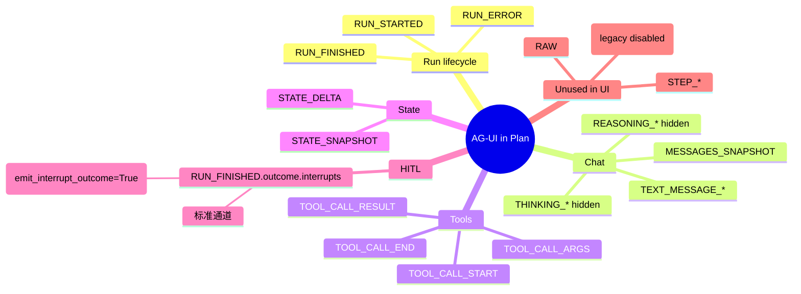

### 4.2 Run lifecycle

| Event | 何时发 | Client 处理 | 用户可见 |
|-------|--------|-------------|----------|
| `RUN_STARTED` | run 开始 | `isRunning = true` | 否 |
| `RUN_FINISHED` | run 结束(成功或带 interrupt) | `isRunning = false`;若是 interrupt 走 `useInterrupt` | gate UI |
| `RUN_ERROR` | 失败 / stream 半截断 | 失败状态 | 是(在 chat 里) |

**Plan 特殊点:**

* `agui_server._make_agui_handler` 在 stream 结束时如果没看到 `RUN_FINISHED` 或 `RUN_ERROR`,会**主动发一个** `RUN_ERROR(code="INCOMPLETE_STREAM")`,防止 client 永远等。
* `agui_server` 还会在 handler 出 `CancelledError`(客户端断开)时静默退出,不再补 event。

### 4.3 Chat messages

| Event | 何时发 | Client 处理 | 用户可见 |
|-------|--------|-------------|----------|
| `TEXT_MESSAGE_*` | LLM 流式输出 token | append 到 `agent.messages` | 经 `DatabotAssistantMessage` 过滤后 |
| `MESSAGES_SNAPSHOT` | 从 checkpoint 批量同步 | replace/merge `messages` | 同上 |
| `REASONING_*` / `THINKING_*` | provider reasoning channel | 走同 pipeline | **隐藏**(`reasoningMessage={() => null}`) |

*Figure 9 — Chat visibility policy in Plan.*

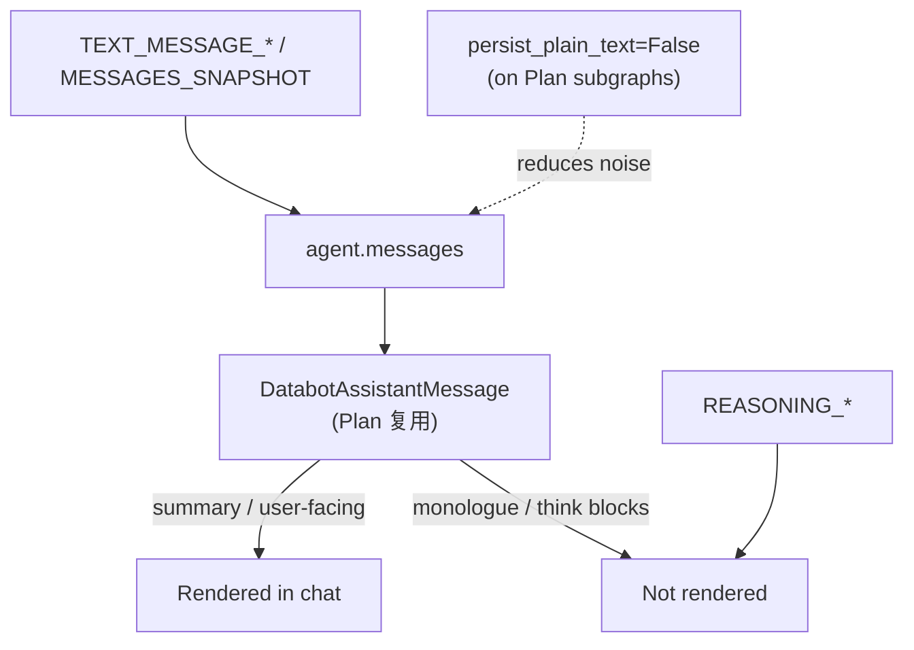

**Plan policy:**

* 三个 ReAct subgraph(`create_plan` / `sub_agent_round` / `adjust_plan`)都用 `persist_plain_text=False`,避免 LLM 在 sub 阶段输出的"我现在要 invoke_agent…"之类的内部 prose 进 checkpoint
* 真正的 user-facing text 只在 `NODE_SUMMARY`(`make_summary_node`)产出,system prompt 也明确告诉 LLM "create/execute/adjust 阶段不要直接回答 user"
* 但 `DatabotAssistantMessage.hideNarration` 兜底过滤:`context:` / `the user wants me to write` / `committed card:` / `- User asked` 等模式会被替换成默认文本,避免污染 chat

### 4.4 Tool calls

| Event | 角色 |
|-------|------|
| `TOOL_CALL_START` | 打开 tool card;CopilotKit 按 `useRenderTool` 名字匹配 |
| `TOOL_CALL_ARGS` | 流式参数写入卡片 |
| `TOOL_CALL_END` | LLM 端 tool call 完成 |
| `TOOL_CALL_RESULT` | 把 `ToolMessage` 结果附到卡片 |

*Figure 10 — Tool call rendering.*

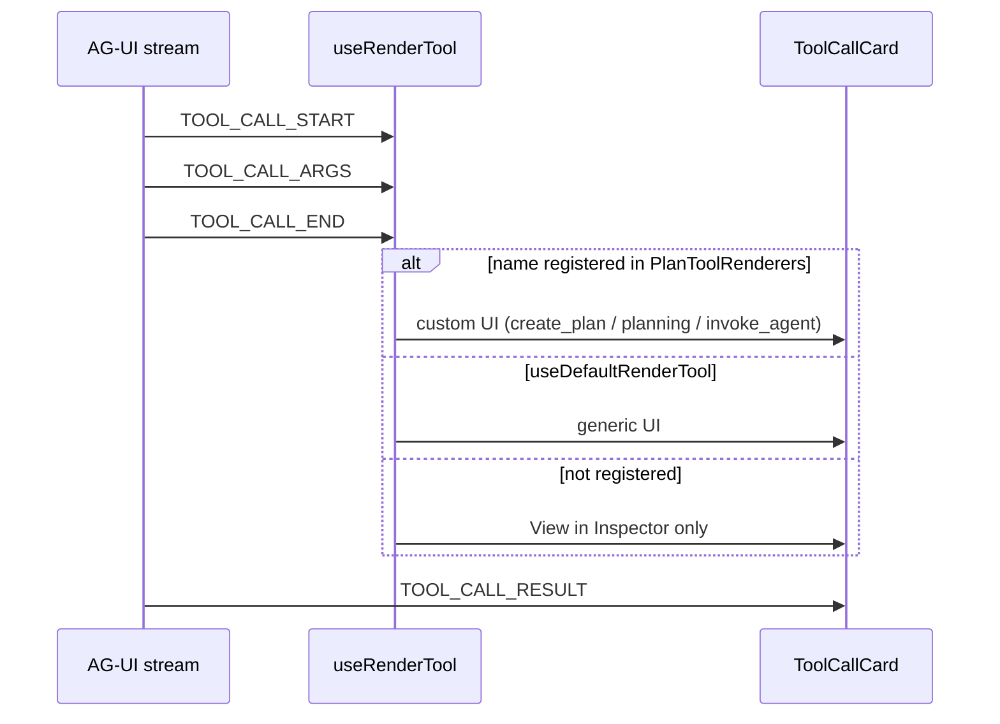

**Plan 特有的 3 个 tool renderer** (见 `frontend/app/components/PlanToolRenderers.tsx`):

| Tool | Renderer | 关键字段 |
|------|----------|----------|
| `create_plan` | "Create plan" card | `title` + `steps` 列表 |
| `planning` | "Planning" card | subtitle 按 `command` (`mark_step` / `update` / `list` / `get` / `create`) 切 |
| `invoke_agent` | "Delegate · {agent}" card | task 摘要 + 输出 |

### 4.5 Graph state

*Figure 11 — Plan state snapshot path.*

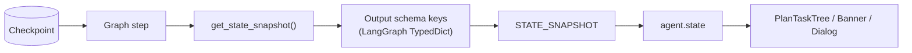

> **Important:** 不在 compiled graph output schema 里的 key 会在 `STATE_SNAPSHOT` 发出去之前被 strip 掉。要确认某个字段是否被 strip,看 `agui_server.py:349-360` 的 `get_schema_keys` log。

**Plan 暴露给前端的 6 个 key**(`agent/plan/ui_state.py:PLAN_STATE_KEYS`):

| Key | Type | 来源 | UI 消费者 |
|-----|------|------|-----------|
| `plan_id` | str | `create_plan` tool | 唯一性,`run_planning` 关联 |
| `stage` | `"create" / "execute" / "adjust" / "done"` | 各 node / `Command.update` 写入 | `PlanTaskTree` stage pill |
| `user_question` | str | `inject_system_prompt` 节点 | debug / future |
| `subagent_rounds` | int | `increment_subagent_round` | task tree 顶部 chip |
| `step_results` | list[{agent, task, output}] | `invoke_agent` tool | task tree 展开区 |
| `plan_snapshot` | {plan_id, title, steps[], progress{}} 或 null | `create_plan` / `planning` / `mark_step` 后 | `PlanTaskTree` 整个面板 |

### 4.6 Human-in-the-loop (interrupt bundle)

Interrupts **不是** 单独的 top-level event,它们随 `RUN_FINISHED` 一起到:

```json
{
  "type": "RUN_FINISHED",
  "outcome": {
    "type": "interrupt",
    "interrupts": [
      {
        "id": "databot-cards-gate",
        "reason": "Review 2 model(s)…",
        "message": "{\"gate\":\"cards\",\"question\":\"…\",\"options\":[…]}"
      }
    ]
  }
}
```

**Plan 特有的部分:**

* 当 `invoke_agent` 触发 nested gate,`nested_hitl.run_specialist_bubbling_interrupts` 用 `as_parent_interrupt(value)` 把 child interrupt 标准化为 `{id, reason, message}`,再 `interrupt(as_parent_interrupt(value))` 沿父图上抛。
* 前端 `databotGateUtils.selectPlanGateInterrupt` 会**优先选 gate JSON 那种 payload,跳过 `plan-nested-hitl-replay` 占位**,所以 dialog 永远不会渲染 replay。
* Resume 路径: dialog 调 `useInterrupt.resolve(payload)` → `runAgent({ resume })` → `agui_server` 收到 resume → `LangGraphAgent.run` → 父图 `Command(resume=…)` → child graph 也在父图 replay 计数推进后被 `Command(resume=…)` 继续。

### 4.7 后端 adapter 关键 flag

`agui_server.py:268-269` 两个 flag 两者都必开:

| Flag | 值 | 原因 |
|------|---|------|
| `emit_interrupt_outcome` | `True` | CopilotKit v2 读 `outcome.interrupts` |
| `enable_legacy_on_interrupt_event` | `False` | 避免 v1 `CUSTOM on_interrupt` 冻结 chat |

---

## 5. Plan agent page

### 5.1 路由 + 布局

*Figure 12 — Plan page regions.*

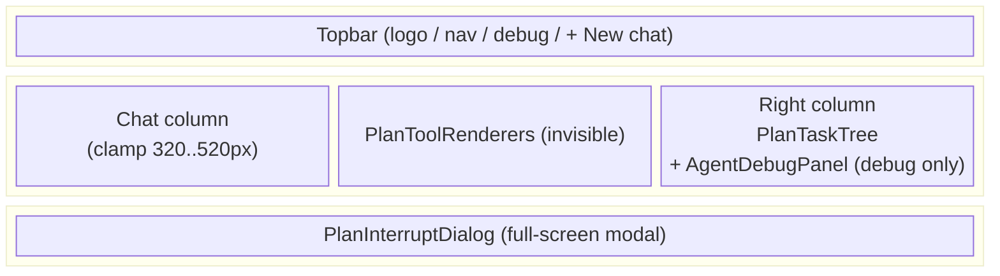

*Figure 13 — Component tree.*

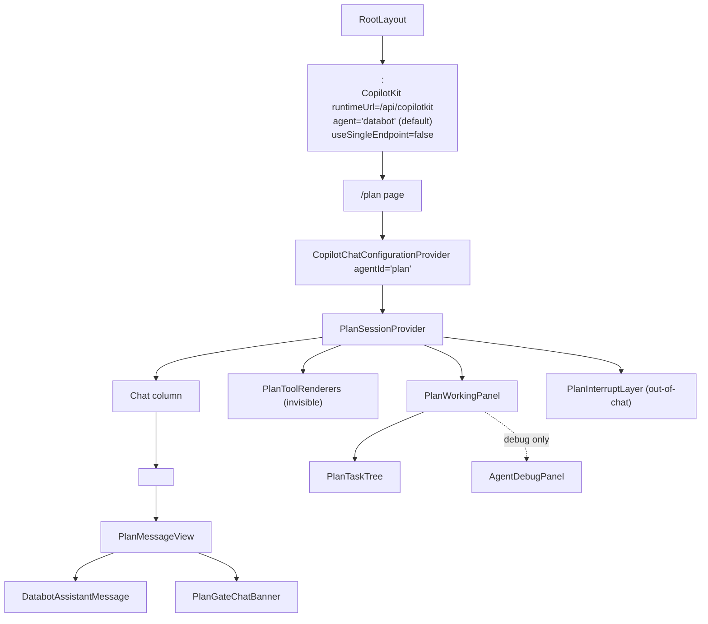

### 5.2 Topbar 组件

* `frontend/app/plan/page.tsx:39-80`
* 左:logo `TP` + "TahoePilot" + tagline "Plan · decompose, delegate, summarise"
* 中:nav tabs,Databot(链接到 `/`) + Plan(active span,`aria-current="page"`)
* 右:Debug toggle + `<PlanNewChatButton>`

### 5.3 Chat column

* `<CopilotChat messageView={PlanMessageView} className="plan-chat" labels={...} />`
* `labels.modalHeaderTitle = "Plan"`
* `labels.welcomeMessageText = "Describe a multi-step task …"`
* **没有**给 `<CopilotChat>` 传 `agentId` prop,完全靠外层 `CopilotChatConfigurationProvider` 注入
* 内部宽度:`clamp(320px, 38vw, 480px)`,窄屏塌成单列(<900px)

### 5.4 PlanMessageView

`frontend/app/components/PlanMessageView.tsx`:

```tsx
<CopilotChatMessageView
  {...props}
  assistantMessage={DatabotAssistantMessage}  // 跨页复用
  reasoningMessage={HiddenReasoningMessage}  // () => null
>
  {({ messageElements, isRunning, messages, interruptElement }) => {
    const showCursor = isRunning && lastMessage?.role !== "reasoning";
    return (
      <div …>
        {messageElements}
        <PlanGateChatBanner />
        {interruptElement}     // 来自 useInterrupt, 但 PlanInterruptDialog
                               // 用 renderInChat:false,这里通常不显示
        {showCursor && <Cursor />}
      </div>
    );
  }}
</CopilotChatMessageView>
```

* `<PlanGateChatBanner />` 在 message 列表底部插一行小提示
* `interruptElement` 来自 chat 级 useInterrupt 注册(如果有);PlanInterruptDialog 自己用 `renderInChat:false`,所以这里一般空
* `HiddenReasoningMessage` 直接 `return null` 隐藏 reasoning 行

### 5.5 PlanTaskTree(右栏核心)

`frontend/app/components/PlanTaskTree.tsx`(257 行)

**结构:**

```
┌────────────────────────────────────┐
│  [Title]  [Stage Pill]              │
│  ████████████░░░░  4 / 7  57%       │
│  ◐ 1 in progress   ✕ 0 blocked     │
│  ○ 2 pending       ⤴ 3 rounds      │
├────────────────────────────────────┤
│ 1. ◐ [databot] Find GMV def  [▸]   │
│ 2. ○ [databot] Get GMV series [▸]   │
│ 3. ○ [knowledge] Get US/EU split    │
│ …                                  │
└────────────────────────────────────┘
```

**数据源:**

| 来源 | 字段 | 用途 |
|------|------|------|
| `agent.state.plan_snapshot` | 标题 / steps / progress | 主要渲染 |
| `agent.state.stage` | 字符串 | 顶部 stage pill |
| `agent.state.subagent_rounds` | 数字 | "X rounds" chip |
| `agent.state.step_results` | list | 步骤展开后显示输出 |

**关键函数:**

* `formatStage(stage)` — 把 stage 字符串映射到 `{label, tone}`,5 个 case(create/execute/adjust/done/idle)
* `ownerFromStep(text)` — 从 `text.match(/^\[([a-z_]+)\]\s*/i)` 抽 owner
* `stepResultFor(step, results)` — **启发式**把 step_results 配到 step(见 §9 Bug-5)
* `truncate(text, max)` — 显示输出限制 1200 字符

**空状态(没有 snapshot 时):**

```
       ◇
   No plan yet
   Ask the Plan agent to break a task into steps…
   Example: "Compare weekly GMV across US and EU …"
```

**未完成响应 `agent.isReady` 的问题**: 空状态在 `!snapshot` 时显示,跟 `!isReady` 是同一个 UI,user 区分不出"agent 还没连上"和"agent 还没建 plan"(§10 K)

### 5.6 PlanToolRenderers

`frontend/app/components/PlanToolRenderers.tsx`(135 行)

```tsx
useDefaultRenderTool();  // 兜底:未注册的 tool 用通用 card

useRenderTool({ name: "create_plan",   parameters: z.object({ plan_id: z.string().optional(), title: z.string().optional(), steps: z.array(z.string()).optional() }), render: … });
useRenderTool({ name: "planning",      parameters: z.object({ command: z.string().optional(), … }), render: … });
useRenderTool({ name: "invoke_agent",  parameters: z.object({ agent_name: z.string().optional(), task: z.string().optional() }), render: … });

return null;  // 纯 hook 注册
```

**`create_plan` 渲染逻辑:**

* 状态: `status !== "complete"` → "Drafting plan steps…"
* 完成: 用 steps 列表渲染 `<ol>`,每行 truncate(200 字符)
* 错误(`isToolErrorText`): 黄色 warning
* 其它: 通用 `<pre>` 截 600 字符

**`planning` 渲染逻辑:**

* subtitle 按 `command` 切:
  * `mark_step` → `Step {idx} → {status}`
  * `update` → "Updating plan"
  * `create` → "Creating plan"
  * `list` → "Listing plans"
  * 其它 → `Plan · {command}`

**`invoke_agent` 渲染逻辑:**

* title: `Delegate · {agent_name}`
* subtitle: `truncate(task, 120)`
* 错误 / 输出 截 900 字符

### 5.7 PlanInterruptDialog(全屏 modal)

`frontend/app/components/PlanInterruptDialog.tsx`(160 行)

```tsx
const { agent, isReady } = useAgent({ agentId: "plan" });
useAgentRefresh(isReady ? agent : undefined, isReady);
const stopDismissed = usePlanStopDismissal(isReady ? agent : undefined, isReady);

return useInterrupt({
  agentId: "plan",
  renderInChat: false,
  enabled: () => !stopDismissed,                       // ⚠ Bug-4: 误用谓词
  render: ({ interrupt, interrupts, resolve, cancel }) => {
    if (stopDismissed) return <></>;
    const selected = pickRenderableInterrupt(interrupt, interrupts);
    if (!selected) return <></>;
    const value = parseGateInterruptMessage(selected.message);
    let body: ReactNode;
    if (value?.gate === "chart") {
      body = <ChartGate value={value} onApprove={…} onSkip={…} onCancel={…} />;
    } else if (value) {
      body = <HumanGate value={value} surface="dialog" onChoose={…} />;
    } else {
      body = <GenericInterruptForm question={genericQuestion(selected)} onSubmit={…} onCancel={…} />;
    }
    return (
      <div className="plan-interrupt-backdrop" role="presentation">
        <div className="plan-interrupt-modal" role="dialog" aria-modal="true">
          {body}
        </div>
      </div>
    );
  },
});
```

* `renderInChat: false` → hook 返回 JSX,组件直接 render
* `pickRenderableInterrupt` 优先从 `interrupts[]` 选第一个 gate payload,跳过 `plan-nested-hitl-replay`
* 三种 body:
  1. `ChartGate` (gate=chart) — 复 databot 的
  2. `HumanGate` (其它 gate) — 复 databot 的,`surface="dialog"` 切文案
  3. `GenericInterruptForm` (不是 JSON gate) — 兜底,简单 textarea

### 5.8 PlanGateChatBanner

`frontend/app/components/PlanGateChatBanner.tsx`(46 行)

```tsx
const pending = agent.pendingInterrupts;
const interrupt = selectPlanGateInterrupt(pending);
const gate = interrupt ? parseGateInterruptMessage(interrupt.message)?.gate : null;
if (!isReady || agent.isRunning || stopDismissed || !gate) return null;
return (
  <div className="chat-gate-notice …" role="status">
    <div className="chat-gate-notice-title">
      <span className="chat-gate-notice-kicker">Action required</span>
      {" — "}
      Submit your decision in the <strong>confirmation dialog</strong>.
      <GateHelpPopover gate={gate} surface="dialog" className="chat-gate-notice-help" />
    </div>
  </div>
);
```

* **数据源是 `agent.pendingInterrupts`** — 不是 `useInterrupt`(见 §9 Bug-2)
* 渲染条件: isReady && !isRunning && !stopDismissed && 有 gate
* 实际效果: banner 出现条件跟 dialog 出现条件错位

### 5.9 PlanNewChatButton + PlanSessionContext

`PlanSessionContext.tsx`:

```tsx
const PlanSessionContext = createContext<PlanSessionContextValue | null>(null);
export function PlanSessionProvider({ children }) {
  const [sessionKey, setSessionKey] = useState(0);
  const resetSessionUi = useCallback(() => setSessionKey((k) => k + 1), []);
  return <PlanSessionContext.Provider value={{ sessionKey, resetSessionUi }}>{children}</PlanSessionContext.Provider>;
}
```

* `sessionKey` 在 reset 时 +1,`<PlanTaskTree key={`tree-${sessionKey}`} />` 等地方用 key 强制 remount
* **与 DatabotSessionContext 几乎一样**(代码 copy-paste,见 §10 F)

`PlanNewChatButton.tsx`:

```tsx
const { agent, isReady } = useAgent({ agentId: "plan" });
const { resetSessionUi } = usePlanSession();
const busy = isReady && agent.isRunning;
const handleClick = () => {
  if (busy) return;
  config?.startNewThread();
  if (isReady) resetPlanAgentView(agent);   // ⚠ 只 isReady 才清
  resetSessionUi();
};
```

* `busy` 不考虑 `!isReady`,导致 `!isReady` 也能点(见 §9 Bug-9)
* `resetPlanAgentView` 见 `planClientReset.ts`:

```ts
const PRESERVED_AGENT_STATE_KEYS = ["tools", "copilotkit"] as const;
export function resetPlanAgentView(agent: AbstractAgent): void {
  const current = (agent.state ?? {}) as Record<string, unknown>;
  const preserved: Record<string, unknown> = {};
  for (const key of PRESERVED_AGENT_STATE_KEYS) {
    if (key in current) preserved[key] = current[key];
  }
  agent.setMessages([]);
  agent.setState({ ...preserved, ...EMPTY_PLAN_STATE });
  agent.pendingInterrupts = [];   // ⚠ 绕过 readonly
}
```

### 5.10 usePlanStopDismissal

`frontend/app/components/usePlanStopDismissal.ts`(53 行)

```ts
const patchedAgents = new WeakSet<AbstractAgent>();
const abortListeners = new WeakMap<AbstractAgent, Set<() => void>>();

function patchAbortToDropGates(agent: AbstractAgent): void {
  if (patchedAgents.has(agent)) return;
  patchedAgents.add(agent);
  abortListeners.set(agent, new Set());
  const original = agent.abortRun.bind(agent);
  agent.abortRun = () => {                    // ⚠ Bug-3: monkey patch
    agent.pendingInterrupts = [];
    abortListeners.get(agent)?.forEach((notify) => notify());
    original();
  };
}

export function usePlanStopDismissal(agent, isReady) {
  const [dismissed, setDismissed] = useState(false);
  useEffect(() => {
    if (!isReady || !agent) return;
    patchAbortToDropGates(agent);
    const onAbort = () => setDismissed(true);
    abortListeners.get(agent)?.add(onAbort);
    const sub = agent.subscribe({
      onRunStartedEvent: () => setDismissed(false),
      onRunFailed: () => { agent.pendingInterrupts = []; setDismissed(true); },
    });
    return () => { abortListeners.get(agent)?.delete(onAbort); sub.unsubscribe(); };
  }, [agent, isReady]);
  return dismissed;
}
```

### 5.11 useAgentRefresh

`frontend/app/components/useAgentRefresh.ts`(22 行)

```ts
export function useAgentRefresh(agent, isReady) {
  const [, bump] = useReducer((n) => n + 1, 0);
  useEffect(() => {
    if (!isReady || !agent) return;
    const sub = agent.subscribe({
      onStateSnapshotEvent: () => bump(),
      onMessagesSnapshotEvent: () => bump(),
      onRunStartedEvent: () => bump(),
      onRunFinishedEvent: () => bump(),
      onRunFailedEvent: () => bump(),
      onEvent: () => bump(),  // 任何 event 都强制 re-render
    });
    return () => sub.unsubscribe();
  }, [agent, isReady]);
}
```

* `onEvent` 兜底:任何 AG-UI 事件都 bump → 全树 re-render
* 这跟 `usePlanStopDismissal` 也订阅 `onRunStarted/Finished` 重复(见 §10 R)
* 在 `!isReady` 时不 subscribe,但 cleanup 也没挂 — 等 isReady 变 true 时换 agent 引用,旧引用不 unsub 会 leak(见 §10 I)

### 5.12 PlanSessionContext 与 page 集成

`/plan` page 把所有右栏组件都用 `key={`xxx-${sessionKey}`}` 强制 remount:

```tsx
function PlanWorkingPanel({ debugEnabled }) {
  const { sessionKey } = usePlanSession();
  return (
    <div className="plan-right-column" data-testid="plan-right-column">
      <PlanTaskTree key={`tree-${sessionKey}`} />
      {debugEnabled && <AgentDebugPanel agentId="plan" />}
    </div>
  );
}
function PlanInterruptLayer() {
  const { sessionKey } = usePlanSession();
  return <PlanInterruptDialog key={`interrupt-${sessionKey}`} />;
}
```

* 重 mount 会把 `useState` / `useEffect` 重置
* 同时 `useAgent({ agentId: "plan" })` 重新请求新 agent 实例

---

## 6. Human-in-the-loop (gates)

### 6.1 Databot(docked)vs Plan(modal)

*Figure 14 — Gate presentation comparison.*

| 维度 | Databot | Plan |
|------|---------|------|
| Surface | right column inline(`<aside>`) | 全屏 modal(`position: fixed; inset: 0`) |
| Container | `GatePanel` (`renderInChat: false`) | `PlanInterruptDialog` (`renderInChat: false`) |
| Body 组件 | `HumanGate` / `ChartGate` 复用的 | **同一个** `HumanGate` / `ChartGate`,`surface="dialog"` 改文案 |
| 解析 | `parseGateInterruptMessage(interrupt.message)` | 同 |
| Live state | `agent.state.review_cards` / `draft_sql` / `cards_selection_summary` 直读 | 同(但 Plan 缺这个) |

### 6.2 Plan 嵌套 HITL 的端到端

*Figure 15 — Nested HITL sequence.*

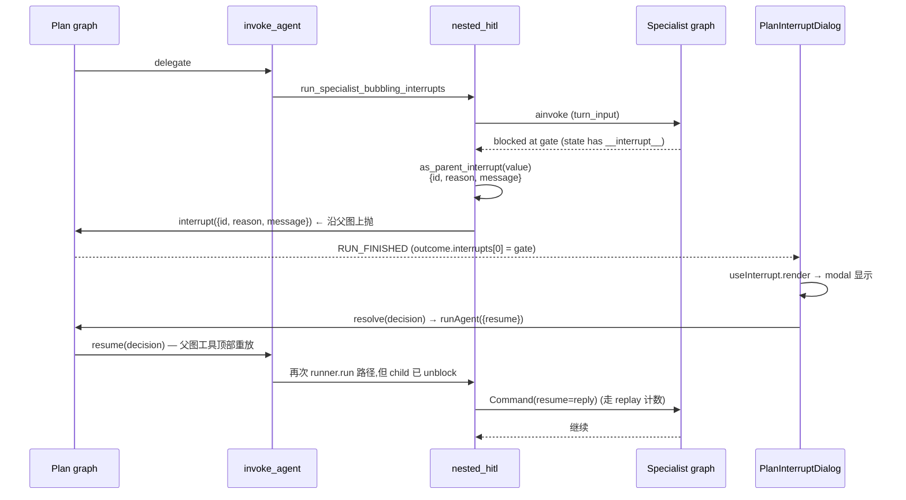

### 6.3 Replay 计数如何工作

`nested_hitl.py:97-133`:

```python
async def run_specialist_bubbling_interrupts(specialist, task, session) -> str:
    graph = _bound_graph(specialist)
    config = specialist.graph_config(session)
    snapshot = await graph.aget_state(config)
    pending = interrupt_values_from_snapshot(snapshot)

    if pending:
        # child 还有 interrupt 等着 resume
        state = dict(snapshot.values or {})
        applied = _applied_by_session.get(session, applied_hitl_rounds(state))
        for _ in range(applied):
            interrupt(_REPLAY_MARKER)   # 消耗掉之前 replay 计数
    else:
        # 第一次进入,起新 turn
        turn_input = await specialist.prepare_turn_input(...)
        if isinstance(turn_input, dict):
            turn_input = {**turn_input, APPLIED_KEY: 0}
        _applied_by_session[session] = 0
        state = await graph.ainvoke(turn_input, config)
        pending = interrupt_values(state)
        applied = 0

    while pending:
        reply = interrupt(as_parent_interrupt(pending[0]))
        state = await graph.ainvoke(Command(resume=reply), config)
        applied += 1
        _applied_by_session[session] = applied
        pending = interrupt_values(state)

    _applied_by_session.pop(session, None)
    return extract_turn_output(...)
```

* `APPLIED_KEY = "parent_hitl_applied"` — 也存进 child state,这样 child graph 自己的 snapshot 能 recall 上次 replay 了多少次
* `_REPLAY_MARKER` 在父图被 `interrupt()` 抛出时是一个**死值**;它的唯一作用就是让 LangGraph 在 replay 父图工具时,把 `interrupt(_REPLAY_MARKER)` 跟之前用户决策的 `interrupt(gate_payload)` 区分开,这样 user 看到的 `RUN_FINISHED.outcome.interrupts[0]` 永远是真 gate,不是 replay
* `selectPlanGateInterrupt` 用 `isPlanReplayInterrupt` 过滤;`id === "plan-nested-hitl-replay"` 或 `reason === "replay"` 且 message 不 parse 成 gate 的话,跳过

### 6.4 interrupt pipeline 总结

*Figure 16 — Interrupt pipeline (both agents, but Plan adds nested layer).*

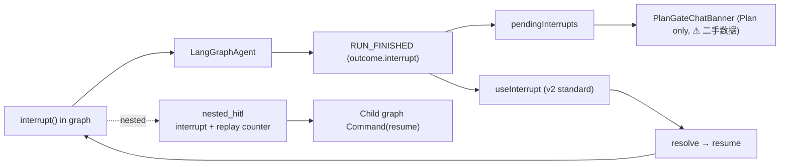

### 6.5 错误恢复

`graph/error_recovery.py` 必须让 `GraphInterrupt` 透传而不是被吃成 tool error message,否则 gate 永远不显示。这条对 Plan 的 nested HITL 尤其关键 — child gate 沿父图上抛时,任何吞 `GraphInterrupt` 的错误处理都会让整个 gate 路径断。

---

## 7. Secondary APIs

Plan 暂时没有自己的 REST 旁路(databot 有 `POST /api/databot/actions` 直写 checkpoint)。

| Endpoint | Agents | Purpose |
|----------|--------|---------|
| `POST /api/copilotkit/*` | All | User messages, interrupt resume |
| `POST /api/databot/actions` | Databot only | Patch card selection / SQL draft |
| — | Plan only(none) | (TODO: 可加 plan 步骤编辑的直写端点) |

> **Future:** 如果要让 user 在右栏直接编辑 plan 步骤(不用等 LLM 调 `planning` tool),需要在 `agui_server.py` 加一个 `POST /agui/plan/actions`,模仿 databot 的实现:验证 action / 调 `build_ui_action_patch` / `aupdate_state` / 回合并后的 state。

---

## 8. Guides

### 8.1 加一个新 tool renderer(Plan)

```tsx
// frontend/app/components/PlanToolRenderers.tsx
useRenderTool({
  name: "my_new_tool",
  parameters: z.object({
    foo: z.string().optional(),
    bar: z.number().optional(),
  }),
  render: ({ status, parameters, result }) => (
    <ToolCallCard
      title="My new tool"
      subtitle={parameters.foo}
      status={status}
      variant="default"
    >
      {status !== "complete" ? (
        <p className="tool-call-muted">Running…</p>
      ) : (
        <pre className="tool-call-pre">{truncate(formatToolResult(result), 600)}</pre>
      )}
    </ToolCallCard>
  ),
});
```

* `useDefaultRenderTool()` 已经调过一次,所有未注册的 tool 会用通用 card
* 不在 PlanToolRenderers 注册的 tool 会落到 "View in Inspector (local only)"

### 8.2 改 PlanState 加字段(同时改 4 处)

1. `agent/plan/state.py:PlanState` — TypedDict 加字段 + `fresh_turn_state_defaults` 加默认
2. `agent/plan/ui_state.py:PLAN_STATE_KEYS` — 加 key(让 AG-UI 不 strip)
3. `frontend/app/components/planTypes.ts:PlanAgentState` — TS interface 加字段
4. (可选) `frontend/app/components/PlanTaskTree.tsx` — 实际读取新字段的地方

> 没有类型同步工具,完全手写对齐。`PLAN_STATE_KEYS` 目前不在 `agui_server` 里真正 filter,只 log 一下 schema keys;真要 enforce 需加 pydantic schema generation 或者 runtime assertion。

### 8.3 让 Plan 在 LangGraph Dev Studio 也能跑

`langgraph.json` 漏了 `plan`:

```json
"graphs": {
  "databot": "./ui.py:databot_ui_agent",
  "knowledge": "./ui.py:knowledge_ui_agent",
  "intent": "./ui.py:intent_ui_agent"
}
```

修法:

1. 在 `ui.py` 加 `async def plan_ui_agent():` 跟其它三个一致(用 `MemorySaver`,但生产是 `AsyncSqliteSaver`)
2. `langgraph.json` 加 `"plan": "./ui.py:plan_ui_agent"`
3. 现在 `agui_server.py:AGUI_AGENTS` 已经引用 `plan` 走 `http.app`,Studio 模式需要从 `langgraph.json` 拿 graph,二者并存需要确认 `agui_server` 不会尝试编译两次

### 8.4 调试"工具掉到 Inspector"

1. 开 Debug → `AgentDebugPanel` 看 `tools` 列表(`agent.state.tools`)
2. 确认 tool name 在 `PlanToolRenderers` 注册
3. 如果是 `create_plan` / `planning` / `invoke_agent` 之外的工具,在 `PlanToolRenderers.tsx` 加一个 `useRenderTool`
4. 如果工具名拼写对、但 state 看不到,看 `agui_server.py` 的 `get_schema_keys` log(确认 graph 暴露了这些 tool schema)

### 8.5 调试"gate 不出来"

1. 开 Debug → 看 `pendingInterrupts` 数量
2. 看 `PlanGateChatBanner` 是否显示;`isRunning` 是否已经变 false
3. `agui_server.py` 的 LangGraphAgent 必须有 `emit_interrupt_outcome=True` 和 `enable_legacy_on_interrupt_event=False` — 改完要重启 `langgraph dev`
4. 看 `graph/error_recovery.py` 是否吞了 `GraphInterrupt`(应该透传)

### 8.6 调试"step tree 一直 pending"

1. 看 `agent.state.plan_snapshot.steps[].status` 是不是 `not_started`(LLM 忘记调 `mark_step`)
2. 看 `agent.state.step_results` 长度,如果 > 0 但 status 没动,确认是 `invoke_agent` 成功但 LLM 跳过了 `mark_step`(可以服务端自动 mark,见 §11 推荐)
3. 看 `PlanTaskTree.stepResultFor` 的启发式有没有配错 step(Bug-5)

---

## 9. Bug catalog(几乎不可用的根因)

按严重度排序。**建议先跑这三个场景验证:**

1. 计划运行到一半刷新页面 → 看 task tree 状态 / interrupt dialog 是否能恢复
2. 两个浏览器 tab 同时跑 plan agent → 看是否串数据
3. plan 执行中点 STOP → 看 banner / dialog / state 是否错乱

### 🔴 Bug-1:Plan nested specialist 的 checkpoint thread 是全局共享的(致命)

**位置:** `agent/plan/stage_tools.py:218`、`agent/plan/plan_agent.py:86-102`、`agent/plan/nested_hitl.py:41-133`、`agent/plan/stage_tools.py:124-149`

**问题:** `invoke_agent` 读 `state.get("session_name")` 当 parent,产 `specialist_session_id(parent, name) = {parent}:{name}`。CLI 路径下 `SessionTurnBuilder.prepare_turn_input` 会写 `session_name` 到 state,但 AG-UI 路径(`agui_server._make_agui_handler → request_agent.run(input_data)`)**不经过** `PlanAgent.prepare_turn_input`,`session_name` 一直是 `""`。

**后果:**

* 任何用户、任何 AG-UI thread id,嵌套 specialist 的 checkpoint thread 都是 `:databot` / `:swe` / `:knowledge` ...
* **两个用户串数据**
* **刷新页面后 nested interrupt 解不出来**,因为 child graph 不知道新 thread id 是哪个
* `_applied_by_session`(process-local dict)跨请求串扰

**修法:** 在 `agui_server._make_agui_handler` 第一次请求前 `aupdate_state(config, { "session_name": input_data.thread_id })`,或者 `SpecialistRunner` 显式接 `parent_session` 从 `LangGraphAgent` 的 `config["configurable"]["thread_id"]` 取。

### 🔴 Bug-2:`pendingInterrupts` 的来源不一致

**位置:** `PlanGateChatBanner.tsx:18-23`、`PlanInterruptDialog.tsx:96-104`、`usePlanStopDismissal.ts:9-19`

**问题:** CopilotKit v2 把 interrupt 走 `RUN_FINISHED.outcome.interrupts`(标准通道)→ `useInterrupt` 消费。`agent.pendingInterrupts` 是 v2 内部另一份缓存。banner 读 `pendingInterrupts`,dialog 走 `useInterrupt`,**两条数据通路**。

**后果:**

* banner 出现条件跟 dialog 出现条件错位
* 在 `RUN_FINISHED` 与 `pendingInterrupts` 被清之间有竞态,banner 经常"闪一下就没了"
* nested HITL replay 没被 banner 过滤(replay id 在 banner 里没处理)

**修法:** banner 改用 `useInterrupt` 的 `interrupts` 数组;`usePlanStopDismissal` 的 `pendingInterrupts = []` 也改成 abort 后用 `useInterrupt` 的清理 API。

### 🔴 Bug-3:`usePlanStopDismissal` monkey-patch `AbstractAgent.abortRun`

**位置:** `usePlanStopDismissal.ts:9-19`

**问题:** 直接给 `agent.abortRun` 赋值新函数;`agent.pendingInterrupts = []` 绕开 v2 的 readonly;WeakSet 防 patch 重入但没防 listener 重入;`onRunFailed` 也置空 `pendingInterrupts` 但不触发 React 重渲染。

**修法:** 用 React state 跟踪最近 abort/fail,在 `useInterrupt.render` 里读 ref early-return,不改 agent 字段。

### 🔴 Bug-4:`enabled: () => !stopDismissed` 误用 useInterrupt 谓词

**位置:** `PlanInterruptDialog.tsx:100-107`

**问题:** `useInterrupt` 的 `enabled` 是 `(event) => boolean`,用来过滤哪些 interrupt 触发 render。Plan 给的是 `() => !stopDismissed`,完全无视 `event`,且每次 render 返回新箭头函数 → useEffect 依赖不稳。

**后果:** 点 stop 后如果处在"未决定 gate"中,SSE 重新订阅会让 dialog 闪一下或漏掉 resume。

**修法:** 改成 `enabled: (event) => !stopDismissedRef.current` 配合 ref,或干脆在 `render` 内 early-return。

### 🔴 Bug-5:`PlanTaskTree.stepResultFor` 启发式

**位置:** `PlanTaskTree.tsx:66-86`

**问题:** "i-th owner-tagged result 配 i-th step mentioning the same owner" — 同一 owner 多次 invoke + 失败重试会配错;`mark_step` 跳过 / `update` 改顺序时 `earlier` 计数会漂;`[]` 上 `indexOf(undefined) === -1`,行为是"最后一个 result"。

**修法:** `invoke_agent` 工具 Command.update 把 `step_index` 一并存到 `step_results[i]`,PlanState 加 `step_links: dict[int, int]` 字段。

### 🔴 Bug-6:`langgraph.json` 没有 plan

**位置:** `langgraph.json:3-7`

**问题:** `plan` 不在 langgraph dev 的 graph registry,但 `agui_server.AGUI_AGENTS` 里有它,且 `ui.py` 也没 `plan_ui_agent` 工厂。

**后果:** 短期不影响功能(用 `http.app` 走私),但 LangGraph Dev Studio 看不到 plan 图。加新 agent 容易踩坑。

**修法:** `ui.py` 加 `plan_ui_agent` 工厂(MemorySaver),`langgraph.json` 加注册。

### 🔴 Bug-7:Plan 工具在 databot 工具注册表里也注册了 + 进程内 plan 字典

**位置:** `tools/plan.py:286-289`、`tools/plan.py:133`

**问题:** `planning` 工具被注册到 `databot,default` / `knowledge,default` / `data_analysis,default` / `swe,default`,但 `_plans: dict[str, Plan] = {}` 是**进程级 dict,没有持久化**。

**后果:**

* databot 用户 A 建的 plan,databot 用户 B 看得到
* `langgraph dev` 重启 → plan 状态全丢,但 `state.plan_snapshot` 还在 checkpoint,再次 `invoke_agent` 报 "No plan"
* `stage_tools._plan_snapshot` 错误信息渗透到 summary 节点

**修法:** plan 加 SQLite 持久化(跟 checkpoints.sqlite 同一个 db,新表),或把 plan_id 改成 agent-thread-scoped(跟 Bug-1 一起)。

### 🔴 Bug-8:`Providers` 硬编码 `agent="databot"`

**位置:** `frontend/app/providers.tsx:7`

**问题:** Plan 页面用 `CopilotChatConfigurationProvider agentId="plan"` 覆盖 chat 的 agentId,但 `<CopilotKit>` 上 `agent="databot"` 是全局默认值。任何"chat 之外的代码"(未来加的 useAgent 缺 agentId)会默认走 databot。

**修法:** 不传 `agent`,或显式 default mapping。

### 🟡 Bug-9:plan 页面的 New chat 在 `!isReady` 时只重挂载不清状态

**位置:** `PlanNewChatButton.tsx:21-28`

**问题:** `busy = isReady && agent.isRunning`,`!isReady` 时 `busy=false`,按钮可点。`if (isReady) resetPlanAgentView(agent)` 跳过,只剩 `resetSessionUi()`。新 mount 的 `useAgent` 可能拿到混合态。

**修法:** `disabled={!isReady || busy}`。

### 🟡 Bug-10:step→result 永远不更新"完成"状态

**位置:** `PlanTaskTree.tsx` + `agent/plan/stage_tools.py:200-258`

**问题:** LLM 经常忘记调 `mark_step`,step 永远显示 ○ pending。即使 `step_results` 有输出,UI 也看不出"做完了"。

**修法:** `invoke_agent` 成功返回时,Command.update 自动 `planning mark_step`(把当前 step 标 completed + 下一步 in_progress)。

---

## 10. Code quality & extensibility

按"改起来成本低 / 影响面大"排序。

### A. 跨页耦合严重

* `PlanMessageView` 用 `DatabotAssistantMessage`
* `PlanTaskTree` 用 `GateDecision.HumanGate / ChartGate`
* Plan 页用 `databot-debug-toggle` 的 CSS class
* `useAgentRefresh` 是 databot 写的,plan 复用
* `usePlanStopDismissal` 又复写 `AbstractAgent`,任何 `useAgent({ agentId: "plan" })` 都触发 patcher

**修法:** 把通用基础设施(过滤、refresh、stop-dismissal)拆到 `frontend/app/agent-ui/`;agent-specific 各自归位。

### B. agentId 在 4 处硬编码同步

加新 agent 必须改 4 处,容易漏(已多次发生)。

**修法:** `agent/registry.py` 上挂 metadata `web_enabled: bool` + `web_description`,`agui_server.py` 和 `route.ts` 都从 `registry.AGENTS.items()` 生成。

### C. Plan state contract 写两份但不强制对齐

* Python: `agent/plan/ui_state.py:PLAN_STATE_KEYS`(只 log 不过滤)
* TS: `frontend/app/components/planTypes.ts:PlanAgentState`
* `PLAN_STATE_KEYS` 目前没在 `agui_server` 里 filter,只 log 一下

**修法:** pydantic → OpenAPI → openapi-typescript-codegen,或者 py-to-ts 双向工具。

### D. `PlanToolRenderers` 注册是 page-level 副作用

每次 mount/unmount 注册/反注册 tool render。`useRenderTool` 是全局副作用,跨 page 切换可能 leak。

**修法:** 顶层 layout 挂一个 `<CopilotToolRegistry />`,集中注册所有 agent 的 renderers。

### E. CSS hard-coded owner 配色

`plan.css:412-416`:

```css
.plan-step-owner--databot { … }
.plan-step-owner--knowledge { … }
.plan-step-owner--swe { … }
.plan-step-owner--diagnostic { … }
.plan-step-owner--data_analysis { … }
```

加 specialist 必须同时改 TS、CSS、可能还要改 `DELEGATABLE_AGENTS` 提示词。

**修法:** CSS 自定义属性 `--owner-${name}`,运行时 `style={{ "--owner-color": OWNER_COLORS[name] }}`。

### F. PlanSessionContext / DatabotSessionContext 几乎 copy-paste

合并成一个 `<SessionUiProvider reset={(agent) => resetXxxAgentView(agent)}>`。

### G. `agui_server.py:525` 死代码

```python
add_langgraph_fastapi_endpoint_unused_marker = None
```

早期实现的残留,删掉。

### H. `stage_tools.py` 每次都 cast `runtime.state` 强类型

```python
full_state = runtime.state if runtime is not None else {}
session = str(full_state.get("session_name") or "").strip()
```

没有类型保护,且 `state.get("session_name")` 永远拿不到值(见 Bug-1)。

### I. `useAgent({ agentId: "plan" })` 的 `isReady` 不可靠

`agent.isReady` 第一次 SSE 之前是 false。`useAgentRefresh` 在 `!isReady` 时直接 return(没 subscribe),useEffect cleanup 不挂。等 isReady 变 true,`agent` 引用可能换,旧 ref 不 unsub 就 leak。快速 New chat 多次会积压 dangling subscriber。

**修法:** 改用 `useSyncExternalStore` 包装 `agent.subscribe`,React 18+ 能正确处理 unmount。

### J. 测试空缺

`frontend/tests/` 是空目录,plan 页面没单测。后端 `tests/` 覆盖 `stage_tools` / `nested_hitl` 也不多。`PlanInterruptDialog` / `PlanTaskTree` 的 step-result 启发式特别需要 snapshot 测试。

### K. 缺 Loading / Error 状态

* `PlanTaskTree` 在 `!snapshot` 时只显示空状态,但 `!isReady` 期间也是同一个 — user 区分不出"还没建 plan"和"agent 还没连上"
* `PlanInterruptDialog` 在 SSE 断流(STOP 后)的"重连尝试中"没有指示

### L. Plan 的 Command 链没 type safety

```python
return Command(update={
    "plan_id": key,
    "stage": STAGE_EXECUTE,
    "plan_snapshot": snapshot_for(key),
    "messages": [_ok_tool_message(tool_call_id, text)],
})
```

5 个键,`messages` 是 `ToolMessage`、`plan_snapshot` 是 dict、`stage` 是 str,TS 端 `PlanAgentState` 完全对不上。

### M. `PlanNewChatButton` 的 disabled 态没视觉反馈

`title` 属性写了提示,但 `disabled` 时按钮颜色没明显变灰(`plan.css:107-128` 的 `opacity: 0.45` 仅在 :disabled 时生效)。跟 databot 行为一致,但 plan 的因为 Bug-9 时常"看起来能点但点了没反应"。

### N. `planClientReset` 的 PRESERVED key 列表不健壮

```ts
const PRESERVED_AGENT_STATE_KEYS = ["tools", "copilotkit"] as const;
```

依赖 AG-UI client 内部字段名,客户端升级可能改名。

**修法:** 从 `agent` 实例枚举所有 state key,删掉自己注入的 keys,而不是正向保留。

### O. Plan 摘要节点 `summary` 的兜底质量差

`agent/plan/graph.py:85-116`:

```python
if not text and payload["step_results"]:
    last = payload["step_results"][-1]
    text = str(last.get("output") or "").strip()
if not text:
    text = "Plan turn finished but no summary was produced."
```

没有 step_result 时给占位,user 看到"Plan turn finished but no summary was produced",且进 checkpoint 污染下一轮。

**修法:** summary 失败要 raise 走 error recovery,不是塞占位文本。

### P. `agui_server.py` 没有请求体大小 / 限流

`POST /agui/plan` 接收 `RunAgentInput`,前端不限制 message 长度,后端没 max body size,长 prompt 让 SSE 跑很久。生产部署要注意。

### Q. `enable_legacy_on_interrupt_event=False` 的影响范围

关掉 legacy `on_interrupt` 之后,任何还在用 `useLangGraphInterrupt` 旧 API 的代码会失效。验证: grep `on_interrupt` / `LangGraphInterrupt` 整个前端,确认全清。

### R. `useAgentRefresh` + `usePlanStopDismissal` 双订阅

两个 hook 都 `agent.subscribe(...)`,每个 event 都 bump 两次 render(虽然 React 会 batch),长 run 是性能负担。

**修法:** 合并成一个 `useAgentReactivity` hook,内部 single subscription fan-out。

### S. CSS 命名风格不统一

| 页面 | 风格 | 例子 |
|------|------|------|
| databot | BEM | `databot-card-list`, `databot-card-list-title` |
| plan | flat | `plan-step`, `plan-step-detail`, `plan-step-detail-label` |
| globals | `--db-*` tokens | (因为先有 databot) |

加新 agent 时 token 命名混乱。**这是 cross-agent design system 问题**,不是 plan 单独的。

### T. type/state 同步靠"心电感应"的具体清单

* `agent/plan/state.py:PlanState`
* `agent/plan/ui_state.py:PLAN_STATE_KEYS`
* `frontend/app/components/planTypes.ts:PlanAgentState`
* `frontend/app/api/copilotkit/...` 隐式要求 `tools/plan.py:get_plan_dict` 的 shape 对齐
* `PlanTaskTree.tsx` 假设 `snapshot.steps[].text` 含 `[agent_name]` 前缀,这个约定 backend 没有类型检查

任何一处 schema 漂移都是运行时 bug。

---

## 11. Troubleshooting & recommended fixes

### 11.1 Symptom → Likely cause → Check

| Symptom | Likely cause | What to check |
|---------|--------------|---------------|
| 刷新后 plan_snapshot 没回 | reset 时没保留 snapshot(正常),但 reload 时 `agent.state` 还在初始化中 | `STATE_SNAPSHOT` 是否在第二次 SSE 后到;`useAgent` 的 `isReady` 切换 |
| 刷新后 nested interrupt 解不出来 | `state.session_name` 空,child thread id 变 `:databot`(全局共享) | **Bug-1**,看 `nested_hitl._applied_by_session[session]` 是不是旧 session |
| 两个用户串数据 | 同上,child thread id 全局共享 | **Bug-1** + **Bug-7** |
| Banner 闪一下没 | `pendingInterrupts` 跟 `useInterrupt` 数据不同步 | **Bug-2** |
| Dialog 闪一下没 | `useInterrupt` predicate 重入 + SSE 重连 | **Bug-4** |
| STOP 后 dialog 不消失 | `usePlanStopDismissal` 没 patch 到 / 没触发 | **Bug-3** |
| Step 永远 pending | LLM 忘调 `mark_step`;或 step↔result 配错 | **Bug-5** + **Bug-10** |
| Tool 掉到 Inspector | 没在 `PlanToolRenderers` 注册 | 加 `useRenderTool({ name, ... })` |
| Gate 不出来 | `emit_interrupt_outcome` 没设 / legacy 通道启用 | `agui_server.py:268-269` |
| `state` 字段总是空 | key 不在 output schema | `agui_server.py:349-360` 的 `get_schema_keys` log |
| Plan 工具在 databot 上也能用 | `tools/plan.py` 用 `bind_tool_to_agent("databot,default")` 全部注册 | 设计上就是允许(但 `_plans` 进程级共享 → **Bug-7**) |
| `langgraph dev` Studio 看不到 plan | `langgraph.json` 漏注册 | **Bug-6** |
| `useState`/ref leak | `useAgent` + `useEffect` cleanup 不到位 | **I** |
| 切 page 后 tool render 重复 | `<PlanToolRenderers />` 是 page-level 副作用 | **D** |

### 11.2 推荐的修复优先级

| 周次 | 工作 | 解 Bug |
|------|------|--------|
| W1 | **Bug-1**(plan thread scoping) + **Bug-2**(banner/dialog 统一) + **Bug-4**(useInterrupt 谓词) | 解决 80% "几乎不可用" 的体感 |
| W1 | **Bug-3**(取消 stopDismissal 的 monkey patch) + **Bug-7**(plan 持久化) | 解决刷新/重启后丢失状态 |
| W2 | **A+B 拆分**(agent 通用组件 vs 特定组件) + **D**(`<CopilotToolRegistry />`) + **B**(4 处 agentId 同步) | 大幅提高可扩展性 |
| W2 | **E**(CSS owner 配色参数化) + **F**(SessionContext 合并) + **N**(PRESERVED 健壮) | UI 收尾 |
| W3+ | **C**(plan state contract 自动生成) + **J**(snapshot 测试) + **I**(useSyncExternalStore) | 防回归 |
| W3+ | **Bug-5 / Bug-10**(step↔result 显式 linkage) | 体验补完 |

### 11.3 一句话总结

**后端:** Plan agent 的"按 agent 名解嵌套 HITL + 进程内 plan 字典"是核心不稳因素(Bug-1 + Bug-7),所有"刷新后失效/多人串数据"的体感基本都来自这两个。

**前端:** Plan 页面是"databot 页面改了三处 + 借了几个组件"拼出来的,缺独立的 design system、缺独立的状态同步层、缺 `useSyncExternalStore` 的现代订阅;`usePlanStopDismissal` 这种 monkey-patch 加上 `useInterrupt` 的 predicate 误用,会触发 SSE 重连相关的边缘问题。

**最便宜的修复:** 把 Bug-1 修了之后,99% 的"为什么刷新一下 step 结果就丢了 / 为什么我决定完 gate 之后 plan 不动了"会消失。建议先动手这块。

---

## 12. Source index

### 12.1 Backend

| 主题 | 位置 |
|------|------|
| Plan agent 入口 | `agent/plan/plan_agent.py` |
| Plan 外层图 | `agent/plan/graph.py` |
| 3 个 subgraph(create/execute/adjust) | `agent/plan/subgraphs.py` |
| Plan 工具(create_plan / planning / invoke_agent) | `agent/plan/stage_tools.py` |
| 嵌套 HITL 上行 + replay 计数 | `agent/plan/nested_hitl.py` |
| `Plan` / `StepStatus` / 进程内 registry | `tools/plan.py` |
| `PlanState` TypedDict | `agent/plan/state.py` |
| `PLAN_STATE_KEYS` 白名单 | `agent/plan/ui_state.py` |
| Plan 注册到 agent registry | `agent/registry.py:136-140, 148-156` |
| AG-UI HTTP server | `agui_server.py` |
| LangGraph → AG-UI adapter | `ag_ui_langgraph.LangGraphAgent`(第三方,`.venv/lib/.../ag_ui_langgraph/agent.py`) |
| Checkpointer | `langgraph.checkpoint.sqlite.aio.AsyncSqliteSaver` |
| GraphInterrupt 透传 | `graph/error_recovery.py` |
| `interrupt_values` / `ainvoke_resolving_interrupts` | `agent/turn.py` |

### 12.2 Frontend

| 主题 | 位置 |
|------|------|
| Root CopilotKit provider | `frontend/app/providers.tsx` |
| Next.js CopilotKit 代理(HttpAgent 列表) | `frontend/app/api/copilotkit/[...path]/route.ts` |
| Plan 路由 | `frontend/app/plan/page.tsx` |
| Chat message view(过滤) | `frontend/app/components/PlanMessageView.tsx` |
| Databot 工具过滤(Plan 复用) | `frontend/app/components/DatabotAssistantMessage.tsx` |
| Tool renderers | `frontend/app/components/PlanToolRenderers.tsx` |
| 右栏 task tree | `frontend/app/components/PlanTaskTree.tsx` |
| 全屏 modal | `frontend/app/components/PlanInterruptDialog.tsx` |
| Chat 小提示 | `frontend/app/components/PlanGateChatBanner.tsx` |
| New chat + session key | `frontend/app/components/PlanNewChatButton.tsx` + `PlanSessionContext.tsx` + `planClientReset.ts` |
| Agent 字段 reactivity | `frontend/app/components/useAgentRefresh.ts` |
| Stop 状态 | `frontend/app/components/usePlanStopDismissal.ts` |
| Gate 解析 / 通用组件 | `frontend/app/components/GateDecision.tsx` + `databotGateUtils.ts` |
| Debug 面板 | `frontend/app/components/AgentDebugPanel.tsx` |
| Plan state TS shape | `frontend/app/components/planTypes.ts` |
| Plan CSS | `frontend/app/plan.css` |
| Gate 通用 CSS tokens | `frontend/app/databot.css`(被 layout 全局 import) |
| `globals.css` tokens | `frontend/app/globals.css`(`--db-*` 系列) |

### 12.3 配置

| 主题 | 位置 |
|------|------|
| LangGraph dev 入口 + http.app | `langgraph.json` |
| Python entry: `databot_ui_agent` / `knowledge_ui_agent` / `intent_ui_agent` | `ui.py`(`plan_ui_agent` 缺失,见 Bug-6) |
| CopilotKit / AG-UI / Next.js / React 版本 | `frontend/package.json` |
| AG-UI client / langsmith 第三方 | `frontend/node_modules/@ag-ui/*` |
