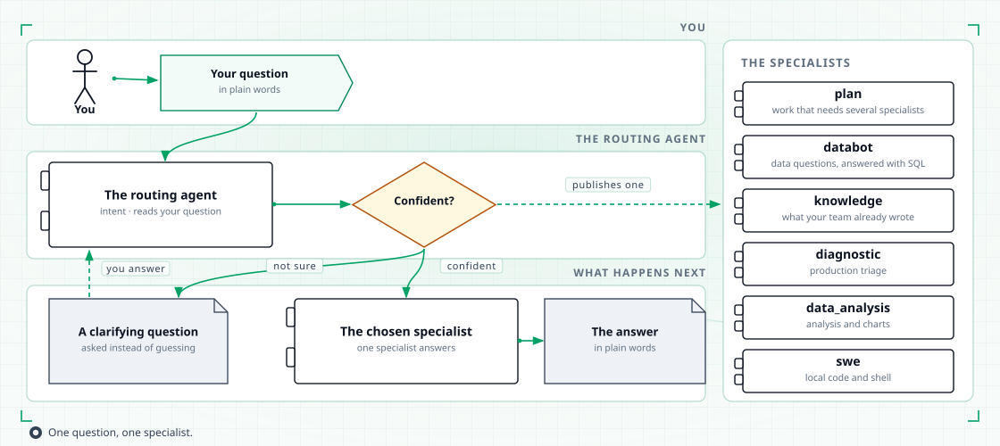
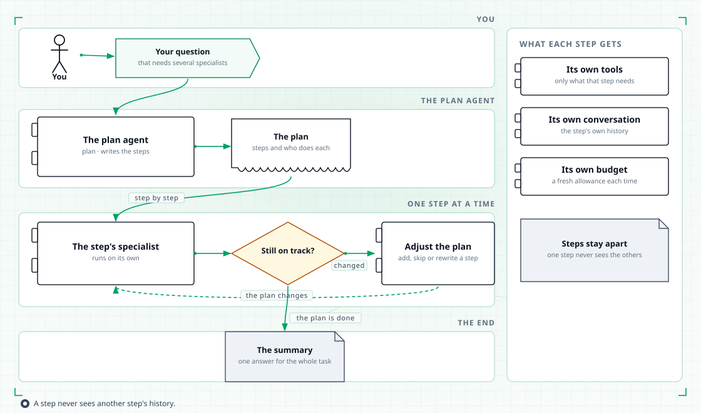

# The seven agents

Ask a question in plain language. TahoePilot picks the specialist that can answer it, and that specialist calls your tools on your behalf.

## What an agent is

An agent is a specialist that reasons with a language model and calls tools for you.

- It reads your question and the conversation so far.
- It decides which tool to call next, then reads what the tool returned.
- It repeats until it can answer, then writes the answer as text.

Tools that touch your data platform, your catalog or your infrastructure only read. A few agents can also run code on the machine TahoePilot runs on, and those are named below.

The platform keeps every agent in one catalog. The catalog is a class that holds every agent the platform can create. It is assembled once at startup, and each agent is built once and then reused, so asking it for an agent is cheap.

## The seven agents

| Agent | What it is for | What it can reach |
|---|---|---|
| **intent** | The default entry point. It works out which specialist should answer, then hands the question over. | Nothing itself. It only chooses who answers. |
| **plan** | Work that needs more than one specialist. It writes a plan, runs the steps, and adjusts the plan when the work changes. | The other five specialists, plus the tools that write and track a plan. |
| **databot** | Data questions answered with SQL and evidence. | The DataHub glossary and catalog, your dbt models, Hive and Trino table metadata, and read-only SQL on Trino. |
| **knowledge** | Questions answered from what your team already wrote down. | Indexed team documents and Jira tickets, the DataHub catalog and lineage, S3 objects, read-only Kubernetes, public web search, and the files and shell on the machine it runs on. |
| **diagnostic** | Production triage: what broke, and where. | Kubernetes pods and logs, Airflow through MCP, Trino and Hive metadata, and S3 objects. |
| **data_analysis** | Open-ended analysis and charts. | Trino and Hive, S3 objects, and a Python sandbox for analysis and charts. |
| **swe** | Local code edits and shell work. | The files and shell on the machine it runs on, and public web search. It edits local files. |

Each specialist has its own set of tools and its own tool budget per turn. The full list of tools and what each one can reach is on the [Tools](tools.md) page.

## How your question reaches a specialist

<figure class="tp-diagram">
  
  <figcaption>One question, one specialist — unless the work needs several.</figcaption>
</figure>

The default agent is intent. It classifies your question into one kind of work — data, knowledge, production, analysis, code, or a plan — and publishes the name of the specialist that should answer.

- One label: the question goes to that specialist.
- Several labels: the request needs more than one specialist, so it goes to the plan agent.
- Not sure: it asks you a clarifying question and classifies again, up to two rounds.

The classifier states how confident it is. Below its confidence threshold it does not guess. It asks you instead. If it still cannot decide after the allowed rounds, the turn ends with a question rather than an answer from the wrong specialist.

You can also skip the routing and start a specialist yourself: `tahoepilot --agent databot`.

## How the plan agent splits work

<figure class="tp-diagram">
  
  <figcaption>A plan delegates each step and adjusts when the work changes.</figcaption>
</figure>

When one question needs several specialists, the plan agent writes a plan first: a list of steps, each with the specialist that should do it. Then it works through the plan.

- Each step runs on its own specialist, with that specialist's own tool budget and its own conversation. The steps do not see each other's internal history.
- What one step finds becomes the input to the next, so the specialists build on each other.
- If the work changes while it runs, the plan agent adjusts the plan instead of starting over. It can mark a step done, add a step, or rewrite a step.
- The turn ends with a summary that pulls the steps together into a single answer.

The number of rounds is capped, so a plan that keeps changing stops instead of looping.

## How one turn runs

One turn at a time. When you send a message:

1. **The turn is accepted.** Your question starts a fresh context on top of the saved history of that session.
2. **The agent runs.** It reasons, calls a tool, reads the result, and repeats.
3. **Approvals interrupt.** When a step needs your decision — which tables to use, whether a query may run — the run pauses and the question is shown to you. Your answer resumes the same run. The work already done is not repeated.
4. **The turn is committed.** The answer and the state of the run are written to the session's checkpoint, so your next message continues where you left off.
5. **The answer comes back as text.**

History is kept per session in a SQLite checkpoint. Start a new session and the agent starts fresh.

## Where to go next

- [Databot](databot.md) — how a data question is answered, step by step.
- [Architecture](architecture.md) — the components and how a request moves through them.
- [Tools](tools.md) — every tool, what it reaches, and which agent holds it.
- [Getting started](getting-started.md) — install the platform and ask your first question.
