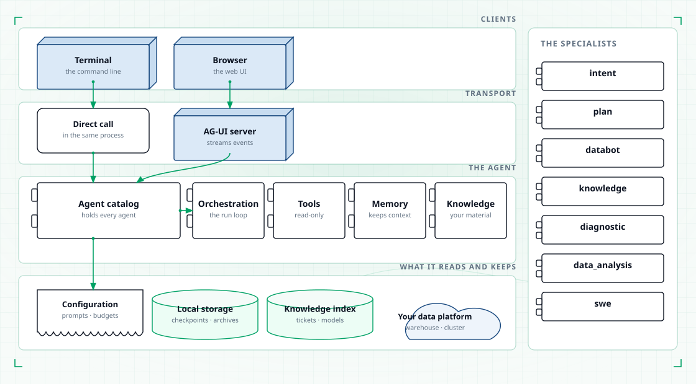
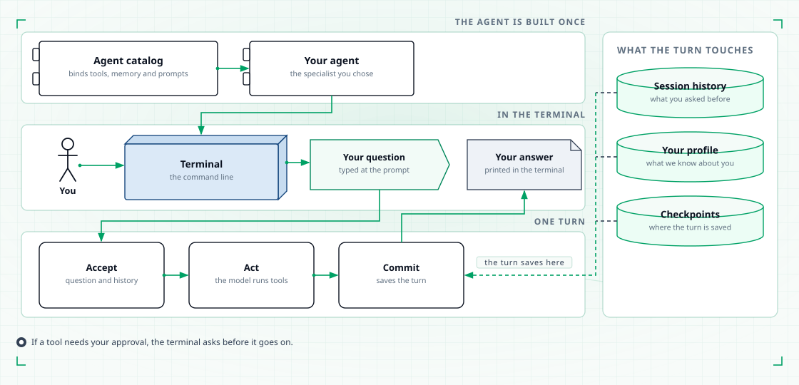
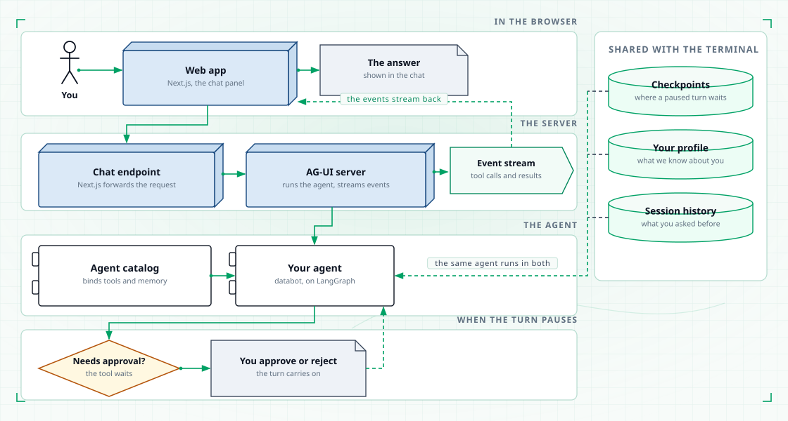
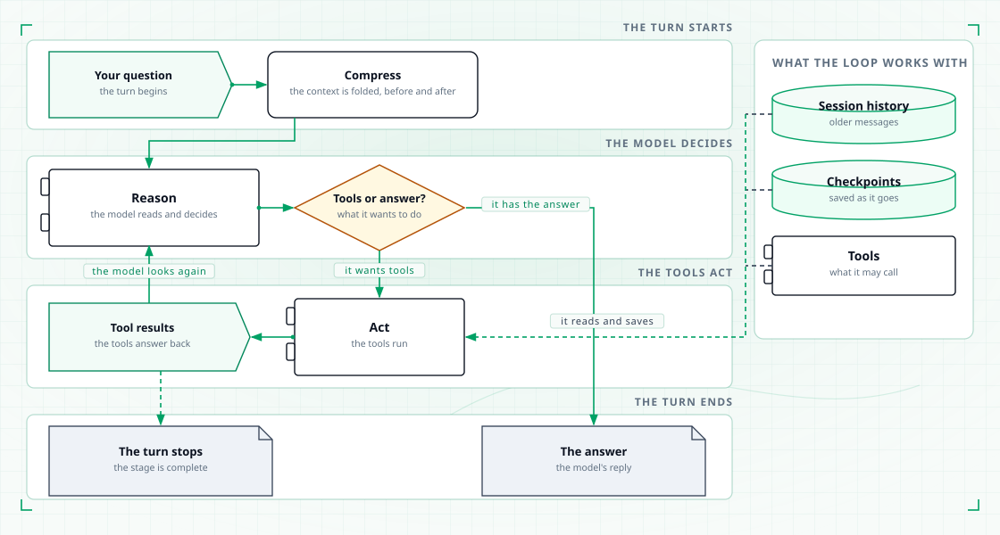
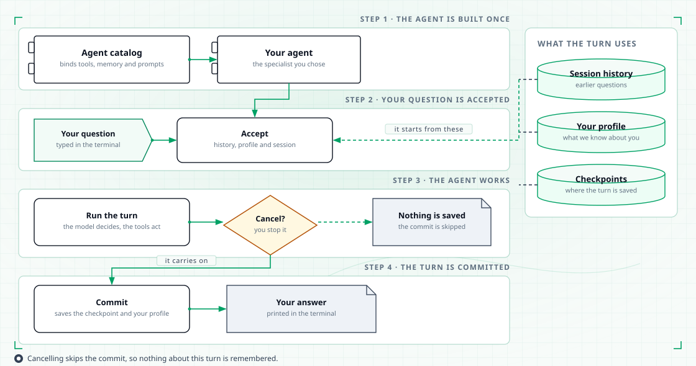
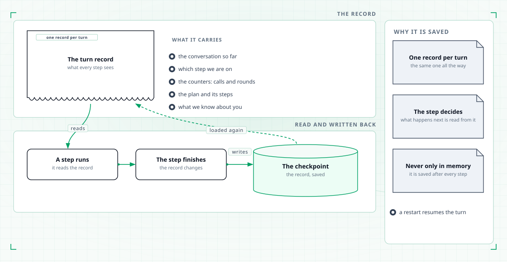

# Architecture

TahoePilot is a multi-agent assistant for data teams. A user asks a question; an agent
answers it by reasoning with an LLM and calling tools against the team's data platform
and knowledge base.

This page is the map. Each capability has its own page with the details.

## The pieces

<figure class="tp-diagram">
  
  <figcaption>Both clients reach the same agent catalog; tools, memory and knowledge sit behind the compiled graph.</figcaption>
</figure>

| Piece | What it is |
|---|---|
| **Agent catalog** | A class that holds every agent the platform can create. It is assembled once at startup, so asking it for an agent is cheap. |
| **Agent** | An object with a compiled graph that handles one user turn. Created by name through the catalog. |
| **Specialist** | An agent that does the work with tools: databot, knowledge, diagnostic, data_analysis, swe. |
| **Orchestrator** | An agent that only decides who does the work: intent routes one question to one specialist, plan breaks a task into steps and delegates them. |
| **Tool registry** | The class that holds every tool an agent can call, grouped by family and granted by scope. |
| **Connection registry** | The class that holds the credentials and endpoints each tool family talks to. |
| **Session store** | Where the saved state of each conversation lives, keyed by session id. It is the source of truth for history. |
| **Knowledge base** | The index of your tickets, dbt models and documents, queried before the model answers a question about your team. |
| **Turn** | One user message and everything the agent does until it answers. It has an accept phase (work out what to send) and a commit phase (persist the result). |
| **Gate** | A pause that waits for a human. Databot uses two of them before any query runs. |

## How a turn flows

The terminal and the browser run the same machinery; only the entry point differs.

<figure class="tp-diagram">
  
  <figcaption>One terminal turn, from the question to the answer.</figcaption>
</figure>

<figure class="tp-diagram">
  
  <figcaption>The browser path streams the same work as tool cards.</figcaption>
</figure>

Inside a turn, the agent runs a reasoning loop: the model decides what to do, the tools
act, the model looks at the result and decides again. The loop ends when the model
answers in plain text, a budget runs out, or a stage is complete.

<figure class="tp-diagram">
  
  <figcaption>Think, act, look at the result, repeat — until there is an answer.</figcaption>
</figure>

<figure class="tp-diagram">
  
  <figcaption>The lifecycle of one turn. Cancelling skips the commit, and only the last text of the turn is returned.</figcaption>
</figure>

<figure class="tp-diagram">
  
  <figcaption>One record travels through a turn, and is written to a checkpoint after every step.</figcaption>
</figure>

## Principles

These explain most of the structure.

1. **Behaviour lives in configuration, mechanics live in the platform.** Prompts, step
   prompts, budgets, which tools an agent may use, which MCP servers it accepts and how
   it is described to the router are all configuration. Changing what an agent does
   rarely needs a deployment. See [Configuration](configuration.md).

2. **Tools do not know their agents.** A tool registers itself by name; each agent lists
   the tools it wants. A name that does not exist is caught immediately rather than
   silently leaving an agent with nothing. See [Tools](tools.md).

3. **Read-only by default, humans approve anything consequential.** Warehouse, object
   storage, cluster and catalog tools are read-only, and SQL goes through a read-only
   guard. Databot will not run a query until a person has approved both the tables and
   the query. The tools that can change things run on your own machine.

4. **State lives in checkpoints.** Conversation history, loop counters and pipeline state
   are all saved state, keyed by session id. A restart resumes a session, and one compiled
   graph serves every session.

5. **Specialists do the work; orchestrators decide who does it.** Routing and planning
   never touch your data themselves. Each delegated specialist runs on its own history,
   so a child's work never mixes into the parent's messages.

6. **Context is managed in layers, and nothing is lost.** Long tool results are offloaded
   to disk first, older turns are folded next, and summarization runs last. Everything
   removed from the conversation is archived and can be read back. See [Memory](memory.md).

7. **Errors are information for the model.** A failed call is classified and returned as a
   structured result with a type, a retry hint and, where one exists, an alternative. The
   model can recover from it. Transient failures are retried first.

8. **Optional parts degrade gracefully.** The knowledge base, the cluster tools and the
   browser UI are optional extras. If one is missing or unreachable, its tools are
   skipped with a warning and the rest keeps working.

## Where to go next

| Page | Read it to… |
|---|---|
| [The seven agents](agents.md) | See which specialist handles which question |
| [Databot](databot.md) | Follow a data question through its stages and gates |
| [Tools](tools.md) | Browse everything the platform can read |
| [Memory](memory.md) | Understand checkpoints, compression and profiles |
| [Knowledge](knowledge.md) | Understand retrieval from your team's material |
| [Web UI](web-ui.md) | Use the browser client |
