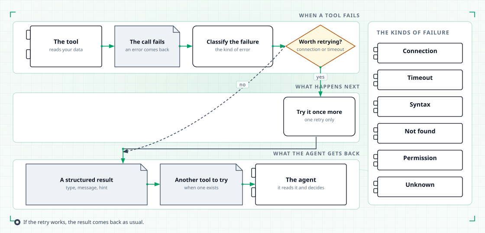
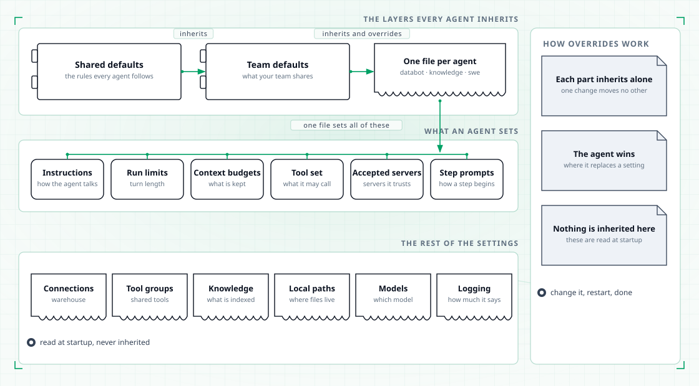
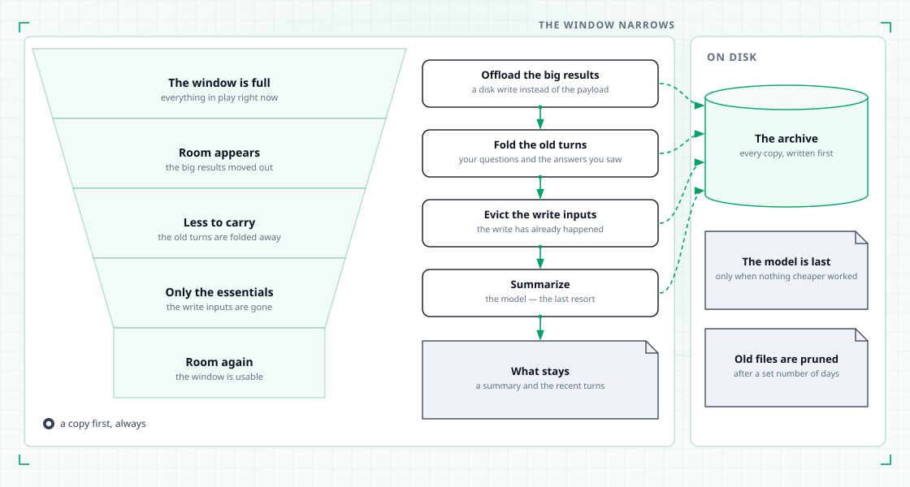
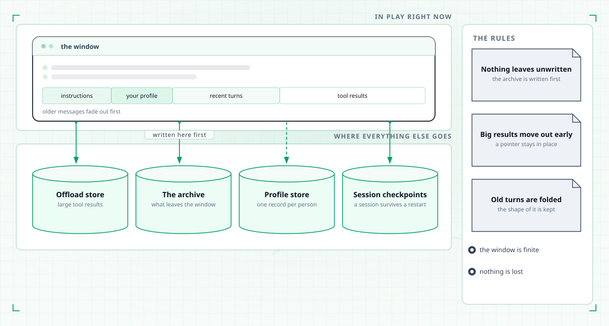
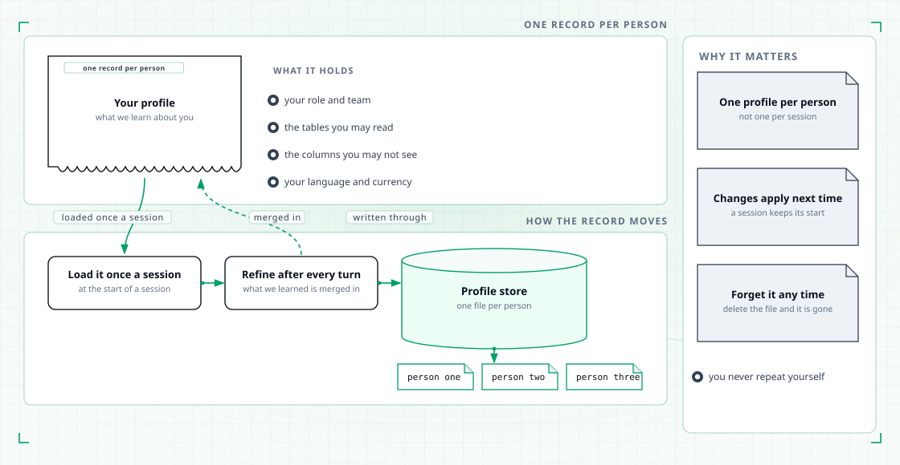
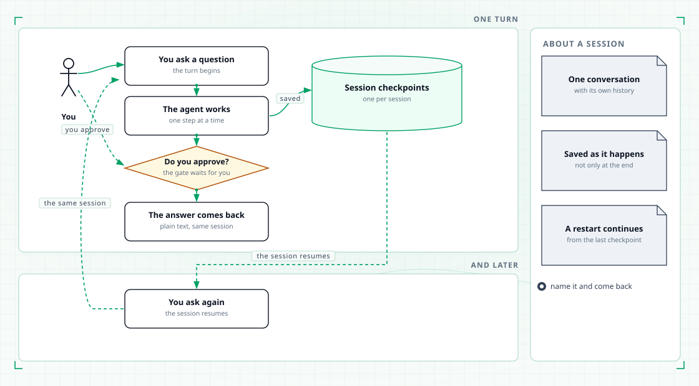
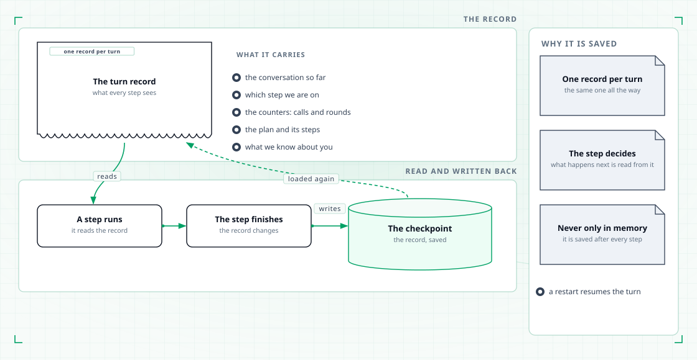
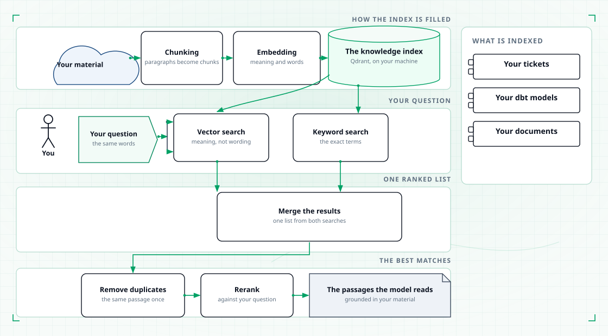
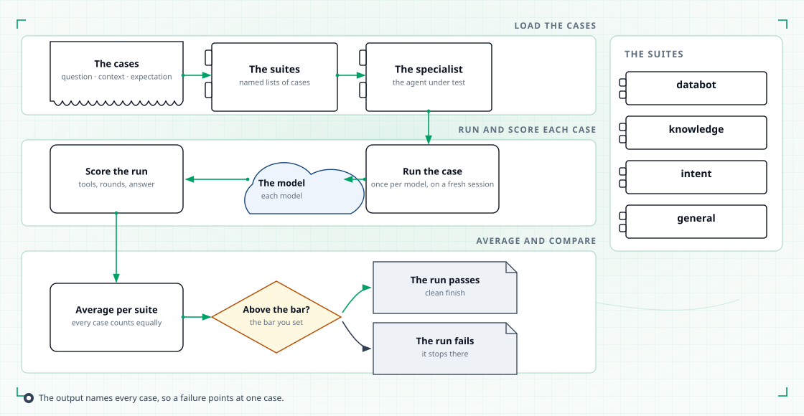
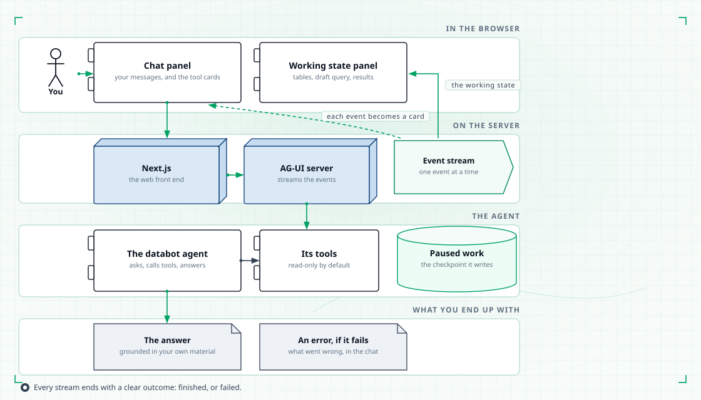

# Capabilities

The platform is a set of capabilities that fit together. Each one below says what it is
for, what the mechanism behind it looks like, and where to go deeper.

Two rules run through all of them:

- **Read-only by default.** Everything the platform reads, it reads without changing
  anything. Anything that would change something waits for you.
- **Configured, not coded.** Each capability is tuned through configuration, so changing
  how it behaves is not a deployment.

## Tools

Tools are the read-only actions the platform can take on your behalf: reading your
warehouse, your object storage, your catalog, your cluster and your team's indexed
material. There are fifty-two of them, grouped into families, and each agent is granted
a named set of them.

You ask about a table, and the agent lists schemas, describes columns and runs a query.
You ask why a job failed, and it reads the pod, its events and its log. The families are
data (Trino, Hive, S3, DataHub), knowledge (indexed Jira tickets and dbt models, the
public web) and infrastructure (Kubernetes, and the machine the platform runs on).

Read-only is enforced. A query tool accepts one read statement: a SELECT, a WITH, a
SHOW, a DESCRIBE or an EXPLAIN. Anything that writes is rejected before it reaches the
warehouse. Catalog lookups reject changes. Cluster tools only list and describe. Your
Trino permissions remain the real boundary.

A few tools can change things: a shell, a Python runner and a file editor. They act only
on the machine TahoePilot runs on. Only swe, knowledge and databot hold them, and
data_analysis holds the Python runner.

Every call has a ceiling. A query returns 100 rows by default and flags a cut. An object
read stops at 256 KB. A shell command stops after two minutes. Each agent has a per-turn
budget of tool calls; when it runs out, the agent answers with what it has.

A failed call is not a dead end. It is classified, retried if it is worth retrying, and
returned to the agent as a structured result the agent can reason about.

<figure class="tp-diagram">
  
  <figcaption>A failed call comes back as information, not as a crash.</figcaption>
</figure>

In words:

1. **The call fails**, and the failure gets one of six kinds: connection, timeout,
   syntax, not found, permission or unknown.
2. **A connection failure or a timeout is tried once more.** If the retry works, the
   result comes back as usual.
3. **Anything else returns a structured result**: the kind, the message and a hint. Where
   a peer tool exists, it is named as another to try; Hive and Trino cover each other for
   listing and describing tables.
4. **The agent decides.** Nothing is called for it automatically.

Shell commands and Python snippets are never retried, because running them twice is not
safe. If the suggested alternative already failed this turn, the agent is told to stop
and explain instead.

You choose each agent's tools and MCP servers in configuration, then restart.

Details: [Tools](tools.md).

## Configuration

Behaviour lives in configuration, in layers. Shared defaults at the bottom, one file per
agent on top, and each part inherits on its own — the instructions can come from one
parent while the run limits come from another.

You change what an agent does by editing a file and restarting. Nothing is rebuilt.

<figure class="tp-diagram">
  
  <figcaption>Shared defaults, a team layer, one file per agent — and the surrounding settings files.</figcaption>
</figure>

The diagram has three bands:

- **The layers.** Shared defaults hold the rules every agent follows. A team layer holds
  what your team shares. One file per agent sits on top.
- **What an agent sets.** Its instructions, run limits, context budgets, tool set,
  accepted MCP servers, and the prompts that open each step.
- **The rest.** Connections, tool groups, the knowledge index, local paths, models and
  logging. These are read at startup and never inherited.

Where an agent replaces a setting, its version wins. Where it adds to inherited text,
the shared text comes first and the addition follows. A file that inherits from itself is
rejected, and a tool name that does not exist is reported at startup.

Watch for these:

- **Secrets** belong in environment variables, which win over the file. A stale variable
  in your shell beats an edited setting.
- **Budgets.** The router hands each specialist it delegates to thirty tool calls, and
  that wins over the specialist's own file.
- **Timing.** New instructions reach a new session. Other changes need a restart.
- **Gates.** Each databot approval gate has a switch. Turned off, the stage continues
  without you.

Run `tahoepilot -v` to see where your session, profile and logs are kept.

Details: [Configuration](configuration.md).

## Memory

Memory is what the platform keeps between turns and across sessions: the conversation
itself, what it has learned about you, and the payload it moved off to disk when a
conversation grew too large. It has three parts — the context window, your profile and
your sessions — and one record, the state, that carries each turn through them.

A long conversation keeps working, you do not repeat your preferences, and you can stop
and come back. All of it stays on your machine.

The context window is finite, so something has to leave it. Four steps run, cheapest
first, and every copy is written to disk before anything is removed.

<figure class="tp-diagram">
  
  <figcaption>The window narrows in four steps. The model is only asked to summarize when nothing cheaper was enough.</figcaption>
</figure>

1. **Offload the big results.** A tool result over about 2,000 tokens goes to disk. Its
   first lines and the file path stay. This runs on every pass.
2. **Fold the old turns.** From earlier turns, only your questions and the answers you
   saw stay. The tool traffic is archived.
3. **Evict the write inputs.** Once the window is 85 percent full, large inputs to write
   actions become a path. The write has already happened.
4. **Summarize.** If it is still that full, the model folds the oldest part into a
   summary of intent, progress, key facts, what was created, next steps and open
   questions. The most recent tenth of the window stays as it was.

If the summary call fails, the step is skipped and the archive copy remains. The agent
can also ask for compaction itself, and read any archived file back.

Compression runs for knowledge, diagnostic, data_analysis and swe. Databot's stages and
the plan agent rely on their tool budgets instead. The window is 128,000 tokens by
default, so match it to a smaller model. Archives are pruned after 30 days by default,
so a session resumed later may point at a file that is gone. All of these are set per
agent in configuration.

What sits behind it:

<figure class="tp-diagram">
  
  <figcaption>What is in play, and where everything else goes: the offload store, the archive, the profile store and the checkpoints.</figcaption>
</figure>

In play are the instructions, your profile, the recent turns and their tool results.
Everything else goes to four local stores: large results, the archive, profiles and
session checkpoints.

<h3 id="profiles">Profiles</h3>

A profile is a small record per person: your role and team, the tables you may read, the
columns you must not see, your currency and grain. It is loaded once per session,
refined after every turn, and kept as one file per person.

It also holds your department, region, language, timezone and preferred metrics. Say
once that you report in euros by week, and later sessions start from that.

<figure class="tp-diagram">
  
  <figcaption>One record per person. Delete the file and the profile is gone.</figcaption>
</figure>

At the start of a session, the profile is written into the agent's instructions. After
each turn, the model reads your request and the reply and proposes an update. Empty
values never overwrite what is there. The merged record is saved straight away, and it
shows up in your next session, not the current one.

Pick the person with `tahoepilot -u alice`. Without it, the platform uses the person
stored with the session, then a configured default, then your login name. Delete the
file to forget a profile. Refinement can be switched off per agent.

Details: [Memory](memory.md).

<h3 id="sessions">Sessions</h3>

A session is one conversation under one name. Every turn is saved as it happens, so a
later question — or a later process — continues where the last one stopped instead of
starting again. Different names never mix.

<figure class="tp-diagram">
  
  <figcaption>Ask, work, approve, answer. Every turn is saved.</figcaption>
</figure>

You ask. The agent works one step at a time. At a gate it waits, and the pause is saved.
You approve, and the answer arrives in the same session. Later you ask again, and the
session resumes from its last checkpoint.

Name a session with `tahoepilot -s alice`. Checkpoints live in a local SQLite file. A
specialist that the router or the plan agent hands work to runs on its own thread, so
its history does not mix into yours. On a cluster, point the local paths at storage that
outlives the pod.

Details: [Memory](memory.md).

<h3 id="state">State</h3>

One record carries a turn: the conversation so far, which step the pipeline is on, the
counters, the plan and what is known about you. Each step reads it, advances it, and
writes it back — so a step never starts from scratch, and a restart picks up at the step
it reached.

<figure class="tp-diagram">
  
  <figcaption>The same record, read and written, before and after every step.</figcaption>
</figure>

The record also names the session and the person. Its counters track tool calls and
rounds, and reset each turn. It lists the tools that failed this turn, so the agent does
not retry a dead end. The record is saved after every step, never only in memory. The
agent object holds nothing about your session, so one agent serves every session.

Details: [Architecture](architecture.md).

## Knowledge

The knowledge base holds your tickets, your dbt models and your documents, indexed so
questions can be answered in your team's own words. A question goes out as a vector
search and a keyword search at the same time; the two result sets are merged, the best
matches reranked, and duplicates removed before the agent sees them.

<figure class="tp-diagram">
  
  <figcaption>A question becomes a vector search and a keyword search, merged and reranked.</figcaption>
</figure>

The top band fills the index. Your material is split into chunks. A local model encodes
each chunk twice, for meaning and for words, into a Qdrant collection on your machine.
Indexing is a scheduled job that resumes where it stopped. Re-indexing replaces a
document rather than adding a copy.

The lower bands answer a question:

1. The same model encodes your question.
2. A vector search finds chunks that mean the same thing. A keyword search finds exact
   terms such as ticket keys and table names. A filter applies to both.
3. The two lists merge into one ranking.
4. A second local model reranks the candidates against your question.
5. Each ticket or model appears once, and the best passages go to the agent.

The models are downloaded once, ahead of time, never while you ask. Reranking can be
switched off, and the merged order is then used. The knowledge agent searches Jira
tickets this way; databot's first stage finds related dbt models for your review.

Details: [Knowledge](knowledge.md).

## Evaluation

Evaluation is how you know a change did not make answers worse. A case is a question,
the context it runs in, and what a good answer looks like; a run scores every case,
averages them per suite, and compares the result against a bar.

<figure class="tp-diagram">
  
  <figcaption>Load the cases, run each against a model, score, average, compare against the bar.</figcaption>
</figure>

1. **Load the cases.** Pick the agent and the suites: databot, knowledge, intent or
   general.
2. **Run each case** once per model it lists, on a fresh session.
3. **Score the run** from 0 to 1 on tools, rounds and answer. A routing case scores the
   routing decision instead.
4. **Average per suite.** Every case and every model counts equally. A cancelled run
   counts as zero.
5. **Compare against the bar.** Below it, the run exits non-zero, so a pipeline check
   can stop on it.

The right tools in the wrong order still earn half credit each. Going over the round
budget lowers the score gradually. The agent is built as in production, except its
history stays in memory and compression is off. Cases are small files kept with the
platform, reviewed with the behaviour they cover.

Details: [Evaluation](evals.md).

## Web UI

The browser is the same platform as the terminal. Tool calls arrive as cards while the
agent works, pending actions wait for your approval, and a draft can be edited before it
runs. The same gates apply as in the terminal. Today the browser serves databot.

<figure class="tp-diagram">
  
  <figcaption>Streaming events turn tool calls into cards in the chat.</figcaption>
</figure>

You type into the chat panel. The Next.js front end forwards your message, and the AG-UI
server streams events back: the run started, a tool is calling, the tool finished, the
state changed, the run is over. Each event becomes a card in the chat or an update to
the working state panel, which shows the tables, the draft query and the results. Every
stream ends with an answer or an error. It never hangs half open.

At a gate, the run ends with "action required" and the panel shows the options. Approve,
deny with comments, or ask for a dry run. Your decision resumes the run where it
stopped. A denial sends your comments back to the same stage to try again.

An edit is not a chat message. A change to the selected tables or the draft query is
written straight into the paused work, and you approve what you edited. Only drafts the
current stage owns can be edited. Each chat is its own conversation, stored in the same
local place as the terminal's.

Details: [Web UI](web-ui.md).

## Where to go next

| Page | Read it to… |
|---|---|
| [Getting started](getting-started.md) | Install, connect your data, ask a question |
| [Architecture](architecture.md) | See how the parts fit together |
| [The seven agents](agents.md) | Know which specialist handles your question |
| [Databot](databot.md) | Follow a data question through its stages and gates |
