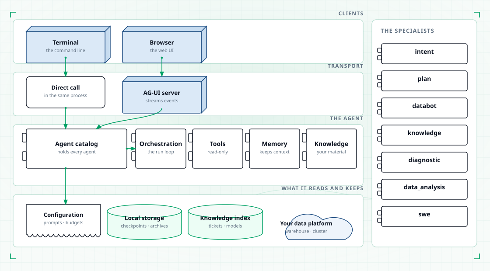
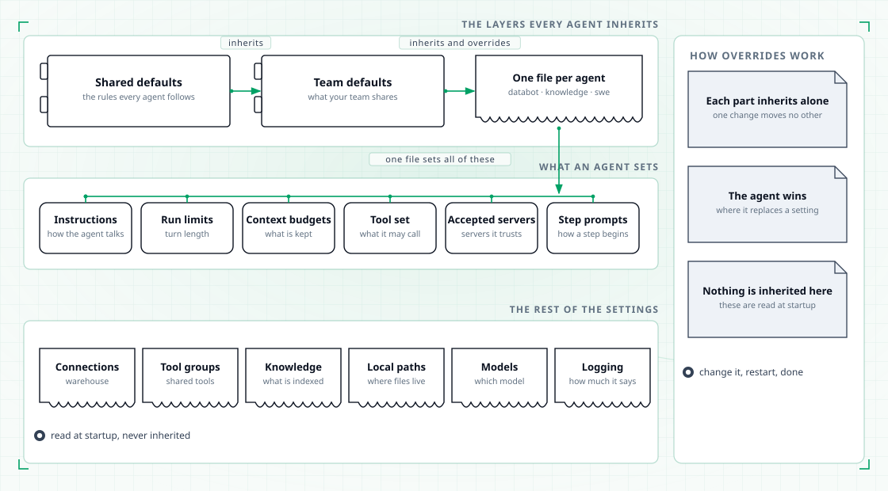

# Configuration

Configuration is how you set what the platform does without changing the platform. Prompts,
budgets, which tools an agent may use, which connections it may reach, where it keeps its
files, how it logs — all of it is configuration.

Change a setting, restart, and the agent behaves differently. You do not rebuild anything.

<figure class="tp-diagram">
  
  <figcaption>Configuration binds to the agent catalog at startup.</figcaption>
</figure>

## How configuration is shaped

Each agent has its own settings file. The file holds that agent's instructions, its
budgets, its tool set, and the connections it is allowed to reach.

On top of that, there is a shared base file. An agent's file extends it, which means the
agent starts from the shared settings and changes only what is different about it. The
result is that the rules every agent follows are written once, and a specialist's
differences are written once, in the place that belongs to them.

<figure class="tp-diagram">
  
  <figcaption>Shared defaults at the bottom, one file per agent on top. The surrounding files are read at startup rather than inherited.</figcaption>
</figure>

Each part inherits on its own. The instructions can come from one parent while the run
limits come from another, so changing one never quietly changes another.

Overrides work the same way everywhere. Where an agent replaces something, its version
wins. Where it adds to something inherited, both are kept — the shared text first, then
the addition as extra lines. Where a shared list of sections decides the order of an
agent's instructions, the agent's own list replaces the shared one entirely, so the agent
must repeat the sections it wants to keep.

## What you can configure

| What you set | What it decides | Where it shows up |
|---|---|---|
| Instructions | The role, the rules and the output format each agent follows | Every answer that agent produces |
| Turn budgets | How many tool calls an agent may make in one turn, how many steps a plan may take, how many times the router may ask you a clarifying question | How long a turn runs before the agent answers with what it has |
| Context budgets | When a long conversation is compressed, which tool results are archived, and how long archives are kept | How much of a long conversation stays in play |
| Tool sets | Which tools an agent may use, and which of its stages may use them | What each agent is able to reach |
| MCP connections | Which MCP servers an agent accepts, and whether a server's tools replace the built-in ones for a stage | What an agent can reach through your own tools |
| Connections | The endpoints and credentials for Trino, Hive, DataHub, Kubernetes, S3 and web search | Whether a tool can reach your platform at all |
| Models | Which model answers, and how hard it tries, how long it may take, how many tokens it may use | The quality, speed and cost of every answer |
| Local paths | Where checkpoints, user profiles, archived results and logs are kept | Where your conversation and history live on disk |
| Logging | Where the log file is and how much it records | What you can read when you need to see what happened |
| Approval gates | Whether a stage stops for a person, or continues on its own | Whether a query runs before you have seen it |

Two of these carry the most weight for day-to-day use. The tool set decides what an agent
can reach at all, and the approval gates decide what runs without you. See
[Tools](tools.md) for what the tool sets mean, and [Databot](databot.md) for what the
gates do.

Secrets are the one thing you should not keep in the configuration files. Every credential
has an environment-variable setting that names the variable to read it from, and the
variable wins over the value in the file. Put your keys in a local environment file at the
project root and they are loaded at startup and never committed.

## Changing configuration safely

Every change needs something restarted or reopened before it takes effect. The table below
is the whole checklist.

| What you changed | What you must do | How you tell it worked |
|---|---|---|
| An agent's instructions | Start a new session | The instructions are written into a session the first time it starts, so a session already running keeps the old ones. A new session picks up the new text |
| An agent's tool set | Restart the platform | Tool sets are bound once at startup, when the agent catalog is assembled |
| A connection or a credential | Restart the platform | Connections are read when the platform starts |
| The model or its settings | Restart the platform | The model is built when the platform starts |
| MCP servers | Restart the platform | The servers are contacted at startup, and the startup output names each one and says whether it answered and how many tools it offered |
| Local paths and logging | Restart the platform | The log file is opened at startup |
| A budget | Restart the platform, and check who is overriding it | The launcher hands most agents a tool-call budget of its own, and that value wins over the one in the file. A budget you raise in the file may not be the budget you get |

Two things catch people out. First, an exported environment variable silently overrides
the file it is supposed to be standing in for, so a stale variable in your shell beats an
edited setting. Second, a budget you change may be replaced by the launcher's own default
before the agent ever sees it.

To check what the platform is actually using, start it with the verbose switch:
`tahoepilot -v`.

It prints where your session, your profile and the logs are kept. The log file itself
records the connections that were opened and the tools that were bound, so it is the place
to look when a change seems to have had no effect.

## Moving between environments is a configuration change

Running on your own machine and running on a cluster are the same platform with different
settings. You switch between them by changing configuration, not by changing the platform.

| What differs between a local run and a cluster run | Which setting carries it |
|---|---|
| Where your conversations and archives live | The local paths |
| Which warehouse, catalog and cluster it talks to | The connections |
| Which model answers | The model settings |
| Which user the session belongs to | The user identity |
| Where the log ends up | The logging settings |

Two of these need care. On a cluster, the local paths should point at storage that
survives the pod, or the conversation is lost when the pod ends. And the user identity
should be set per person, because the profile that follows a user carries their
permissions and their preferences.

## Where configuration sits

Configuration is read once, at startup, and bound to the agent catalog. The catalog is a
class that holds every agent the platform can create, and it is assembled once at startup,
so asking it for an agent is cheap. That assembly is where your settings meet the
running system. See [Architecture](architecture.md) for the components around it.

## Where to go next

| Page | Read it to… |
|---|---|
| [Tools](tools.md) | See what each tool reaches and which agent holds it |
| [Architecture](architecture.md) | Understand the components configuration binds to |
| [The seven agents](agents.md) | See which specialist each instruction set belongs to |
| [Memory](memory.md) | Understand what the context budgets protect |
| [Getting started](getting-started.md) | Connect your data and ask a first question |
