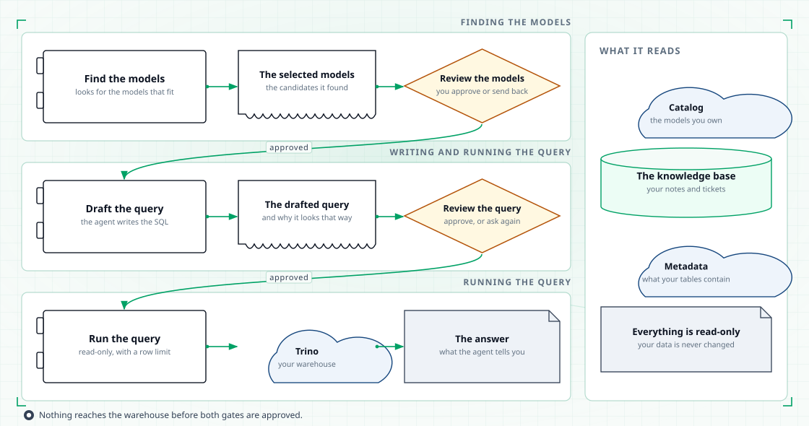
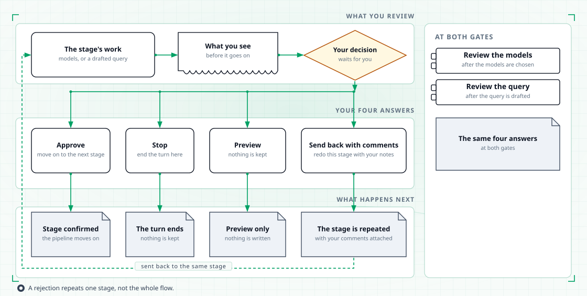

# Databot graph

Databot is a pipeline, not a single step. This page walks through the whole thing: four
phases, two gates inside them, and the places a turn can end. The text covers everything
the diagrams show, so you can read it without them.

<figure class="tp-diagram">
  
  <figcaption>Every stage hands over to the next one. Two of them stop and wait for you.</figcaption>
</figure>

## How the pipeline decides what runs next

The pipeline is a LangGraph state machine with four phases: find the tables, write the
query, run the query, and summarise. One field records the current phase. After each phase,
the graph reads that field and picks the next phase. The routing is fixed. No model decides
where the turn goes.

The two gates are not phases of their own. The table gate ends the first phase, and the
query gate ends the second. A gate is a LangGraph interrupt: the run pauses, its state is
saved, and it continues from the same point when you answer. Finished stages do not run
again.

The first two phases each run a small ReAct loop with their own tools and budget. The
search phase can look up models and glossary terms, but cannot run queries. The query phase
can describe tables, check a draft and propose a query, but cannot search for new tables.
The run phase has one tool: the one that runs a query on Trino.

## The stages

| # | Stage | What it reads | What it does | What it produces |
|---|---|---|---|---|
| 1 | **Find the models** | Your question, the DataHub glossary, the dbt model index, and tables you approved in earlier turns | Searches for candidate models, then commits the ones to show you, with the metrics and dimensions to use on each. | Proposed tables, plus any metric conflicts |
| 2 | **Review the models** | The proposed tables | Writes a reason for each of your four choices and a summary of the selection, then pauses for you. | Approved tables, a request to search again, or a stop |
| 3 | **Draft the query** | The approved tables only, plus your comments after a send-back | Describes the tables, writes a read-only query, and asks Trino to explain it so the query is known to parse. Writes a reason for each gate choice. | A draft query and its reasons |
| 4 | **Review the query** | The draft and its reasons | Pauses for you. | An approved query, a request to redraft, or a stop |
| 5 | **Run the query** | The approved query | Runs it on Trino, read-only, with a limit of 100 rows. | Columns and rows, or an error |
| 6 | **Answer** | Your question, approved tables, metric conflicts, the query, the first five rows, and every gate decision | Writes one message for you. | The answer, or the reason the turn stopped |

Stage 2 and stage 4 are the gates. Nothing reaches the warehouse before both of them.

Each ReAct loop has a budget of 10 tool calls and one round where the model thinks without
calling a tool. The search ends as soon as at least one table is committed, or when the
budget runs out. The draft ends when both the query and its reasons exist, or when the
budget runs out. Either way, the gate opens next. An exhausted search can reach the table
gate with no tables, and an exhausted draft can reach the query gate incomplete. You then
send it back, stop, or (for the query, in the browser) write the query yourself.

When a dbt metric disagrees with a glossary term, the search records the disagreement and
shows it to you. It never fixes it, because Databot does not edit your models.

## What you can decide at a gate

A gate offers four answers, and the platform reads them the same way at both gates.

| Your answer | What happens |
|---|---|
| **Approve** | The stage is confirmed and the pipeline moves on. |
| **Send back with comments** | This stage is cleared and repeated with your comments. The work starts again from this stage, not from the beginning. |
| **Stop** | The turn ends here. The query does not run and nothing is written. |
| **Dry run** | The stage is confirmed as if approved, but the turn is not saved to your retrieval history. The pipeline continues exactly as on approve. |

A dry run is not a preview without execution. A dry run at the query gate still runs the
query; the answer then notes that nothing was saved. The flag follows your latest gate
answer. A dry run on the tables followed by an approve on the query counts as approved.

### At the table gate

You see the proposed tables, the metrics and dimensions selected on each, a summary of the
selection, any metric conflicts, and a reason for each choice.

- **Approve** or **dry run** copies the tables under review into the approved set. The
  pipeline moves to the query phase.
- **Send back with comments** clears the candidates, the committed tables, the tables under
  review and the reasons. Your comment is added to the conversation as a review note. The
  search runs again, guided by it.
- **Stop** ends the turn. Your comment becomes the reason. Without one, the reason says you
  halted at the table gate.

In the browser you can narrow the selection before you answer. Names that are not among the
proposed tables are ignored. Approve takes whatever is under review at that moment.

### At the query gate

You see the draft query and a reason for each choice.

- **Approve** or **dry run** copies the draft into the approved query. That copy is the only
  query the run stage uses.
- **Send back with comments** clears the draft, its reasons and the parse check, and adds
  your comment as a review note. The query stage drafts again.
- **Stop** ends the turn before anything runs. Your comment becomes the reason.

In the browser you can edit the query directly before you approve it, or ask for a new
draft with written feedback. A new-draft request clears the current draft the same way a
send-back does.

### Replies the gate does not accept

A reply that names none of the four choices, or an empty reply, changes nothing. The gate
asks again, with a note that it did not understand and a list of the choices. Nothing is
applied or recorded until you give a valid answer.

Either gate can be switched off in Databot's configuration. A switched-off gate does not
pause. It approves on its own and still records an audit entry.

<figure class="tp-diagram">
  
  <figcaption>A rejection returns to the same stage with your comments attached.</figcaption>
</figure>

## Every transition

| From | Event | To |
|---|---|---|
| New question | The turn starts | Find the models |
| Find the models | A table is committed, or the budget is spent | Table gate |
| Table gate | Approve or dry run | Draft the query |
| Table gate | Send back with comments | Find the models, cleared, with your comment |
| Table gate | Stop | Stopped turn |
| Draft the query | Draft and reasons complete, or the budget is spent | Query gate |
| Query gate | Approve or dry run | Run the query |
| Query gate | Send back with comments | Draft the query, cleared, with your comment |
| Query gate | Stop | Stopped turn |
| Run the query | Rows returned, or an error | Answer |

Four rules hold across the table:

- **Loops go back one stage, not to the start.** Sending back the query keeps your approved
  tables.
- **Each loop gets a fresh budget.** The counters reset each time a phase starts, so a
  redraft has the full 10 tool calls again.
- **The gates do not count rejections.** A loop ends only when you approve, dry-run or stop.
- **The run stage always moves on.** Success or failure, the turn goes to the answer. A
  failed query is reported, not retried.

Every valid gate answer adds an audit entry with the gate, your decision, your comments and
the reasons you were shown.

## Where a turn can end

| Outcome | When |
|---|---|
| **Answer** | The query ran and the agent summarised the result. |
| **Stopped by you** | You chose to stop at a gate. The query never ran. |
| **Summary without a result** | The turn ended for another reason and the agent said what it had. |

If the model's answer comes back empty or unusable, Databot writes a plain fallback. It
names the tables, gives the row count or the error, and notes a dry run. It is in Chinese
when your question is in Chinese, and in English otherwise.

A stopped turn gets a fixed message that it was halted at your request, with your reason. A
summary without a result follows a query that failed on Trino, or a run with no approved
query. The answer reports the error.

## What carries over to the next turn

A new question after a finished turn starts the pipeline fresh. Selections, drafts, reasons,
the audit trail, the dry-run flag, the result and the conflicts are reset. The conversation
is kept. Tables you approved before come back as starting candidates, from your retrieval
history. Turns run in the browser are not saved to that history today; terminal turns are.

A message you send while a gate is waiting is not a new question. Answer or stop the gate
first.

## In one paragraph

Your question enters the pipeline, the agent searches for the models it needs and drafts a
query, and it stops twice so you can check both. If you send something back, it is redone
from that stage with your comments attached — you never start over from scratch. If you
stop, nothing runs and nothing is kept.

The stage-by-stage description, with what a good answer looks like, is on the
[Databot](databot.md) page.
