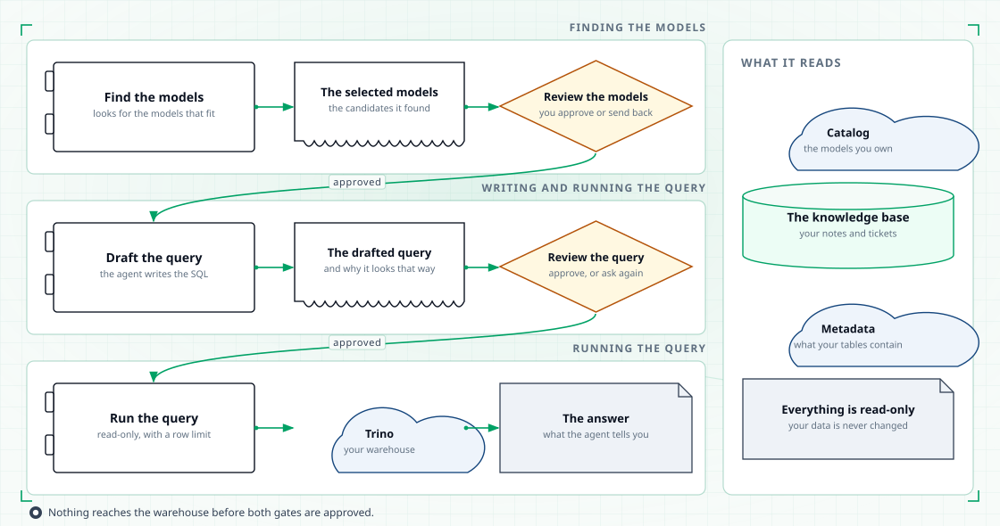
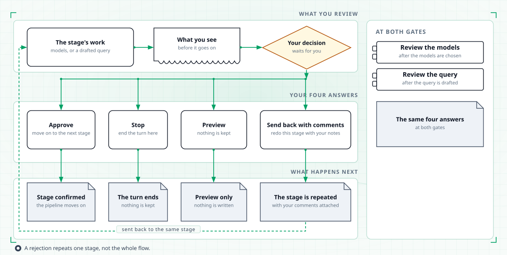

# Databot

Databot answers data questions. It finds the candidate tables, drafts the query, and runs the query only after you approve it.

## What Databot gives you

You ask in plain language: "how many orders did we have last week by region". Databot does the rest in visible stages.

- It finds the dbt models that could answer the question.
- It shows you the candidate tables, with their metrics and dimensions, and asks which ones to use.
- It drafts the query against the tables you approved.
- It shows you the query and asks whether to run it.
- It runs the query and writes an answer that names the tables, the query, and the result rows.

Two decisions are yours: which tables, and which query. Everything else runs on its own.

## The stages your question goes through

<figure class="tp-diagram">
  
  <figcaption>Every stage hands over to the next one; two of them wait for you.</figcaption>
</figure>

1. **Understand the question.** Databot reads your question and the glossary. It looks for the metric you named and the terms around it, so "revenue" means the same thing here as it does in your catalog.
2. **Propose tables.** It searches the dbt models and collects candidates. Each candidate carries its columns, its metrics, its time dimension, its owner, and how other teams use it.
3. **Draft the query.** It writes a read-only query against the tables you chose, and checks that the query parses before showing it to you.
4. **Approval.** It asks you to approve the tables, then the query.
5. **Run.** It runs the approved query on Trino.
6. **Answer.** It writes one answer that names the tables it used, the query it ran, and the first rows of the result.

## The two gates where you decide

<figure class="tp-diagram">
  
  <figcaption>A rejection returns to the same stage with your comments.</figcaption>
</figure>

Each gate gives you the same four choices: approve, dry run, reject with comments, or stop.

| Gate | What it shows you | Choices |
|---|---|---|
| The table gate | The candidate tables, with the metrics and dimensions selected on each, and a short reason for the choice. | Approve the selection, dry run it, reject it with comments, or stop the turn. |
| The query gate | The drafted query, with a reason for each choice. | Approve the query, dry run it, reject it with comments, or stop the turn. |

A dry run behaves like approval except that the turn is not saved to your retrieval history. The query still runs, so you see the numbers without adding the turn to your history.

Stopping ends the turn there. Databot writes back that the turn was halted and why.

### What a rejection does

A rejection with comments sends the same stage back around with your comments attached.

- Rejecting the tables clears the table selection. Databot searches again and comes back with a new proposal, using your comments as guidance.
- Rejecting the query clears the draft. Databot writes the query again and shows you the new draft.

A reply that names no valid option does nothing and asks again. Nothing runs and nothing changes until you pick one of the four options.

## What Databot will not do

The guardrails are checked before anything runs, not by asking the model to behave.

- **Read-only queries.** Every statement is checked before it is sent. A single statement is accepted only when it begins with SELECT, WITH, SHOW, DESCRIBE, DESC or EXPLAIN. An EXPLAIN that would execute the statement inside it is held to the same rule. Anything else is refused. The check is a keyword test rather than a full parse, so pair it with a read-only Trino account.
- **Approved tables only.** The query stage can use the tables you approved at the first gate and nothing else. It does not search for new tables.
- **The approved query only.** The query that runs is a copy of the draft you approved. Editing the draft after approval does not run a different query.
- **A row limit.** A run returns at most 100 rows. When the result was cut short, the answer says so.
- **No writes.** Databot never changes your models, your catalog, or your tables. When a dbt metric disagrees with a glossary term, it records the disagreement and shows it to you at the table gate rather than picking a side.

## What Databot remembers

A turn that you approve is saved to your retrieval history: your question, the tables you approved, and the query you approved. The next question starts with those tables as candidates, so a follow-up on the same data does not start from scratch. The last 30 retrievals are kept per user. Dry runs and halted turns are not saved.

## Ask Databot directly

Databot is also reachable on its own, without the routing step. Run `tahoepilot --agent databot` to open a session with Databot directly.

When a gate pauses in the terminal, the gate prints its question and its options, and reads your answer on the next line. Answer with one of the four option names. To attach comments to a rejection, give the option name and your comment in the bracketed form the terminal expects. To cancel the turn, type quit, exit, q or :q.

In the browser the same two gates appear as a panel, where you can pick the option, edit the selected tables, or edit the query before you approve it.

## Where to go next

- [Databot graph](databot-graph.md) — the full state machine, stage by stage.
- [The seven agents](agents.md) — how Databot fits with the other six.
- [Tools](tools.md) — what Databot can reach, and what stays out of its reach.
- [Architecture](architecture.md) — where Databot sits in the platform.
