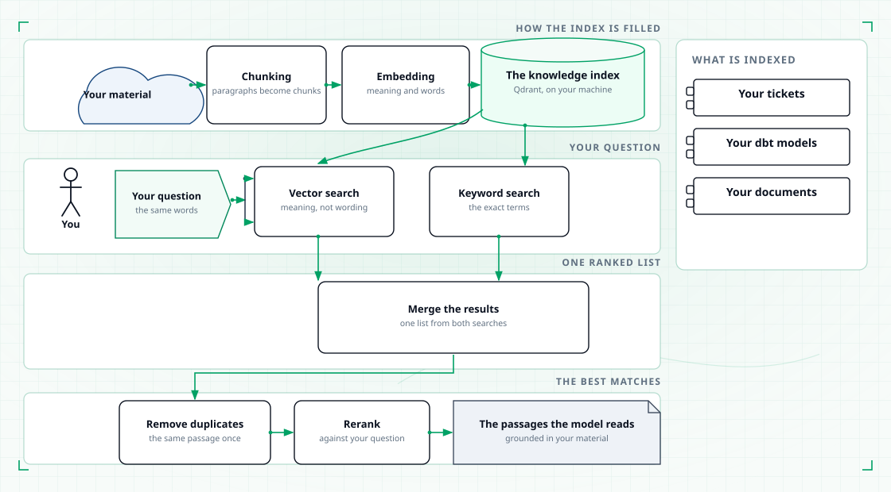

# Knowledge

Your team's own material is indexed so that answers come in your team's words, not in a
model's memory. The knowledge base holds your tickets, your dbt models, and your
documents.

## What the knowledge base holds

| Source | What is indexed |
|---|---|
| Tickets | Each ticket as its own item, with its summary, description, comments, status, priority and links |
| dbt models | Each model with its description, columns, entities, owners, table and metrics |
| Documents | Files from a shared drive: text, markdown, spreadsheets and PDFs |

Everything is stored in a local Qdrant collection. Nothing you index is sent to a
shared service.

## How content gets in

Indexing is a scheduled job, not a side effect of asking a question. It works in two
steps: a plan step that lists the files to index and writes one task per file, then a
run step that processes those tasks and records its progress.

The run is resumable. If it is interrupted, it continues where it stopped. A file that
failed is not marked done, so the next run retries it and only it.

Each source has its own reader. The reader decides how an item becomes a document, how
the document splits into paragraphs, and what each paragraph carries. Everything after
that is shared:

1. **Chunking.** A document becomes paragraphs, and paragraphs become chunks small
   enough to embed. Chunks in a paragraph overlap slightly, so a sentence split across
   two chunks can still be found.
2. **Embedding.** Each chunk is encoded by a local embedding model into two
   representations: a dense vector that captures meaning, and a sparse vector that
   captures the actual words with their weights.
3. **Indexing.** Each chunk becomes one point in the Qdrant collection, carrying both
   representations plus the metadata that lets an answer name its source.

Re-indexing a document replaces it rather than adding a second copy. When the number of
chunks changes, the old points are removed first, so a collection never holds two
versions of the same document.

Indexed text is not truncated. A description that does not fit in one chunk is packed
across several, with the header repeated, instead of being cut short.

## How a question uses the knowledge base

<figure class="tp-diagram">
  
  <figcaption>A question becomes a vector search and a keyword search, merged and reranked.</figcaption>
</figure>

The same embedding model encodes your question, so it can be compared with the indexed
chunks. The question then goes out two ways at once:

- **A vector search** finds chunks that mean the same thing as the question, even when
  they use different words.
- **A keyword search** finds chunks that contain the exact terms, including ticket
  keys, table names and identifiers.

The two result sets are merged, duplicates are removed, and the best matches are
reranked against the question itself before they reach the model. Filtering by
metadata, such as a ticket project or a data layer, is applied to both searches, so a
narrow search is not starved of candidates.

## What a good answer looks like

A grounded answer quotes or points at the passages it used, and names where they came
from — the ticket, the model, the document. When the knowledge base does not cover the
question, the answer says so rather than inventing one.

The tools that perform these lookups are listed in [Tools](tools.md).
