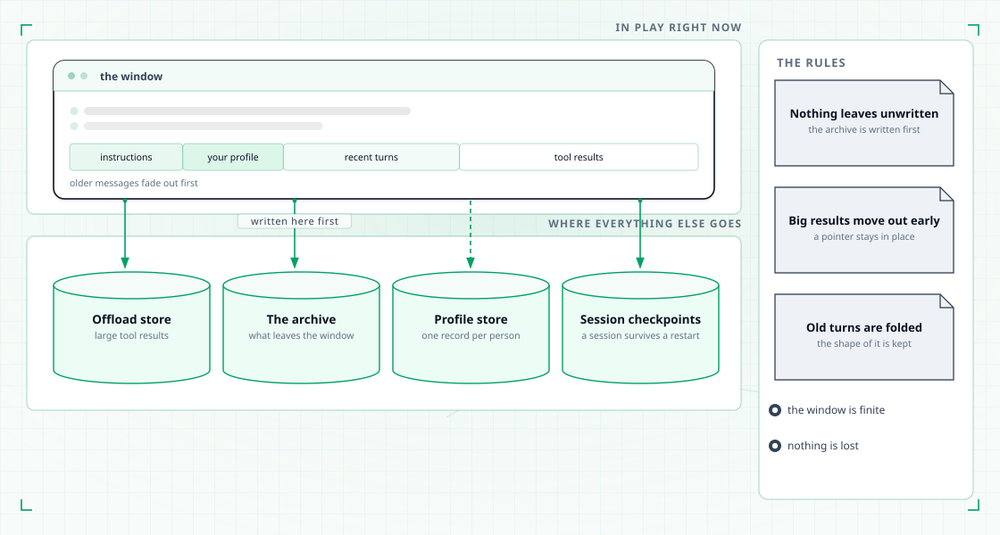
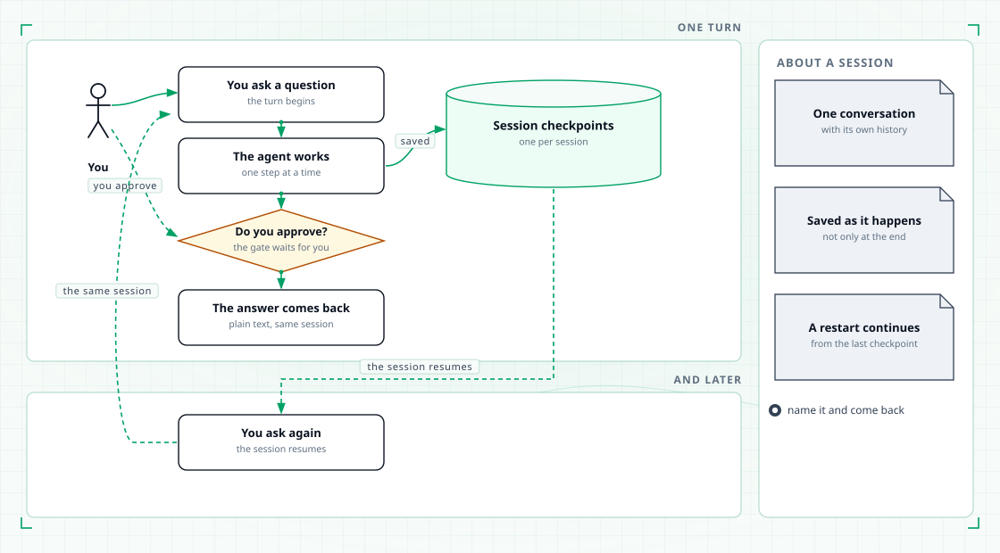
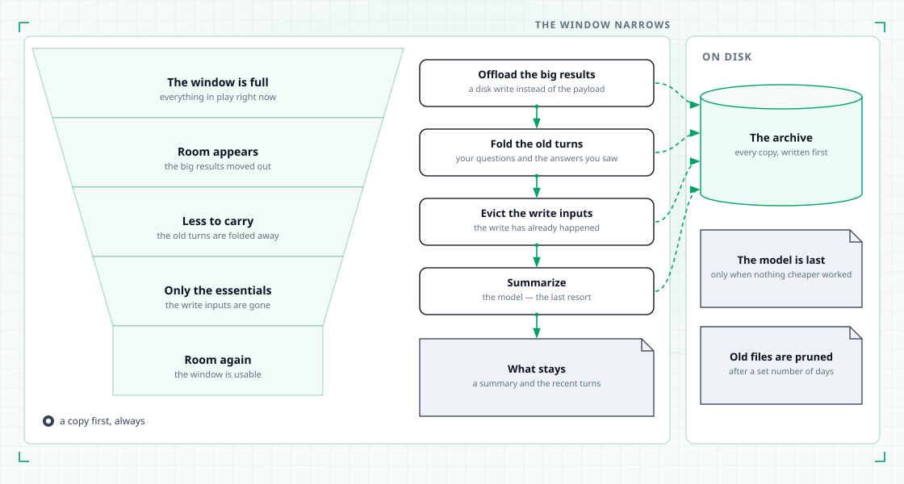
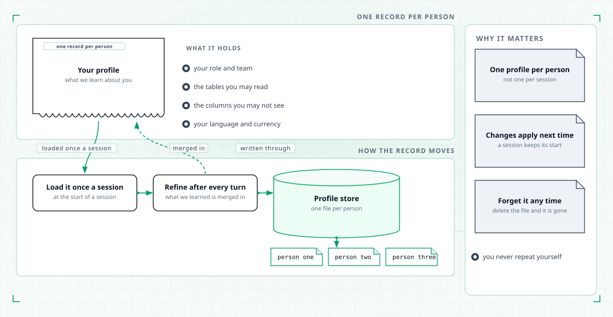

# Memory

The platform remembers three things for you: the conversation you are in, what it has
learned about you, and anything it moved to disk because the conversation got long.

## What is remembered between turns and across sessions

| Kept | What it is | Where it lives |
|---|---|---|
| The conversation | Every message of the current session, plus the working state around it | A local checkpoint store on your machine |
| What it learned about you | Your role, team, permissions, language and analysis preferences | One profile file per user |
| What it moved to disk | Large tool results and older parts of the conversation | An archive folder on your machine |

A session survives a restart, and a profile follows you into the next session.

<figure class="tp-diagram">
  
  <figcaption>The window holds what is in play. Everything that leaves it is written to disk first.</figcaption>
</figure>

## How a session survives a restart

Each session is written to a checkpoint store as the conversation goes, not only at the
end. Start the platform with the same session name and the conversation resumes where
it left off: the earlier questions, the earlier answers, and the work in between.

Name a session when you want to come back to it — `tahoepilot -s alice` — and ask for
the storage locations with `tahoepilot -v`.

Nothing is sent to a shared service. The checkpoint store is local.

<figure class="tp-diagram">
  
  <figcaption>A session is one conversation. Every turn is saved, so the next question continues rather than starts again.</figcaption>
</figure>

## How a long conversation is compressed

A model can only hold so much. When the conversation fills up, older content is
compressed rather than dropped. Four steps run, cheapest first.

<figure class="tp-diagram">
  
  <figcaption>The window narrows in four steps, cheapest first. Everything that leaves it is written to disk before it goes.</figcaption>
</figure>

1. **Offload.** A large tool result — a query output, a file listing — is written to
   disk and replaced by a short preview plus the path to the full content. This runs on
   every pass, because it costs almost nothing.
2. **Fold earlier turns.** From previous turns, only your questions and the answers you
   saw are kept. The tool traffic behind them is archived.
3. **Evict write inputs.** If the conversation is still large, the arguments of write
   actions are replaced by a path to a file. The write has already happened, so the
   payload is no longer needed in the conversation.
4. **Summarize.** Only if the conversation is still too large, the model folds the
   oldest part into a short summary of the intent, the progress so far, the key facts,
   the artifacts created, the next steps and the open questions.

Nothing is thrown away silently. Every step writes the original content to the archive
folder first and leaves the path in the conversation, so the agent can read it back when
an answer needs it. The agent can also compact on its own when it decides the
conversation has grown too long, and it can read an archived file back on request.

Archived files are pruned after a set number of days. A session resumed after a long
gap may point at a file that has already been removed.

## What the platform remembers about you

Your profile is a small record kept per user. It holds your role, department and
region, the tables you may read and the columns you may not, your language and
timezone, your default time granularity and currency, and the metrics and dimensions
you prefer.

The profile is inserted into the platform's instructions at the start of a session, so
you do not have to repeat yourself. It is refined after each turn: the model proposes
an updated profile from your request and the reply, and the platform merges it in.
Empty values never overwrite what is already there.

The profile is applied when a session starts. A refinement made during a session shows
up in your next session, not in the one already running.

<figure class="tp-diagram">
  
  <figcaption>One record per person, refined after every turn and written through to disk.</figcaption>
</figure>

## How to forget a profile

Profiles are plain files in your local data directory. Delete the file for your user
and the next session starts with an empty profile. Ask for a different user and you get
a different profile. There is one profile per user, not per session.

## Where the memory behaviour is set

The switches that decide how much context is kept, when compression starts, which
tool results are archived and how long archives are kept live in the configuration.
See [Configuration](configuration.md).
