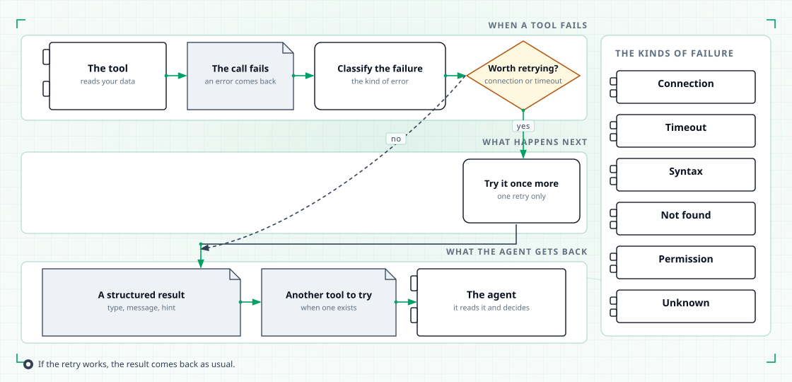

# Tools

A tool is one action the platform can take on your behalf: read a table, run a query, look
up a ticket, check a pod. An agent chooses the action, the platform runs it, and the result
goes back to the agent.

Almost everything a tool does is read. The handful that can change something are marked
in the table below, and they are the ones you should look at twice.

## What a tool can reach

Tools fall into three families.

| Family | What it reaches | Examples |
|---|---|---|
| Data | Your warehouse metadata and tables, your object storage, your catalog | Trino and Hive tables, S3 objects, DataHub datasets and lineage |
| Knowledge | Your indexed tickets and models, and the public web | Jira tickets, dbt models, web search |
| Infrastructure | Your cluster, and the machine the platform runs on | Kubernetes pods and logs, shell commands, local files |

Each family talks to its own system through a connection. A connection holds the endpoint
and the credentials; the tools that need it read them from there.

## The read-only guarantee

The default is read-only, and it is enforced rather than assumed.

- A query tool accepts a single read statement only — a SELECT, a WITH, a SHOW, a DESCRIBE
  or an EXPLAIN. Anything that writes is rejected before it reaches the warehouse.
- Catalog lookups reject anything that would change the catalog.
- Cluster tools only read. They list and describe; they never restart or delete anything.
- Object storage tools only list, read and check the size of objects.

Treat the SQL guard as a safety net against mistakes, not a security boundary. Your Trino
permissions are the real boundary.

The tools that can change things run on the machine TahoePilot runs on, and they are
granted only to the agents that need them.

Anything that writes to your data platform needs an explicit human gate first. A query
does not run until a person has approved it. See [Databot](databot.md) for where that
pause happens.

## Which agent gets which tool

Tools do not know their agents. Each tool registers itself under a name; each agent lists
the names it may use.

- **Scopes.** An agent's tools sit in named buckets. Every agent has a main bucket, and
  some have narrower ones for particular stages — for example databot keeps separate
  buckets for fetching tables, writing the query and running it, and knowledge keeps one
  for catalog lookups. An agent asks for the bucket it needs at that moment, so a stage
  never carries tools it will not use.
- **Connections.** A connection is granted per agent, and often per scope as well. An MCP
  server is reachable only by the agents you allow it for. Servers that fail to start are
  skipped with a warning, and the rest keeps working.
- **Mistakes surface early.** If an agent lists a tool that does not exist, the platform
  reports it at startup instead of quietly handing that agent a smaller tool set.

## What a tool call is bounded by

Every call has a ceiling, so a slow or huge answer cannot take the platform down.

- **Row limits.** A query returns a capped number of rows, with a flag when rows were cut
  off. A listing returns a capped number of entries. An object read is capped by size.
- **Timeouts.** A shell command is cut off after two minutes. A Python snippet runs for
  thirty seconds by default and two minutes at most. Connections have their own timeouts.
- **Budgets.** Each agent has a per-turn budget of tool calls. When the budget runs out,
  the agent answers with what it has instead of continuing.
- **Recovery.** A failed call is classified, retried once when the failure looks transient,
  and handed back to the agent as a structured result carrying a type, a hint and, where
  one exists, an alternative tool to try instead.

<figure class="tp-diagram">
  
  <figcaption>A failed call is classified and returned as a structured result, not lost.</figcaption>
</figure>

## The built-in tools

Every tool the platform ships, what it does, whether it can change anything, and which
agent holds it.

| Tool | What it does | Read-only | Who can use it |
|---|---|---|---|
| Trino: run query | Runs one read-only SQL statement against Trino. Rows are capped by a row limit (100 by default), and a flag tells you when rows were cut off. | Read-only | data_analysis; databot (query execution stage); diagnostic |
| Trino: explain query | Shows the plan for a draft query using SQL EXPLAIN, without running it. Reports a success flag instead of failing outright. | Read-only | data_analysis; databot (SQL stage); diagnostic |
| Trino: list catalogs | Lists the catalogs available on the connection. | Read-only | data_analysis; databot; diagnostic |
| Trino: list schemas | Lists the schemas in a catalog. The catalog defaults to the one in your connection settings. | Read-only | data_analysis; databot; diagnostic |
| Trino: list tables | Lists the tables in a catalog and schema, using your connection defaults. Hive listing is used instead when Trino cannot see them. | Read-only | data_analysis; databot; diagnostic |
| Trino: describe table | Describes a table: its columns and their types. Hive description is used instead when Trino cannot see it. | Read-only | data_analysis; databot (SQL stage); diagnostic |
| Hive: list tables | Lists the tables in a database through the Hive metastore. Trino listing is used instead when needed. | Read-only | data_analysis; databot; diagnostic |
| Hive: describe table | Describes a table's columns and types through the Hive metastore, falling back to Trino. | Read-only | data_analysis; databot (SQL stage); diagnostic |
| S3: list objects | Lists the objects under a path prefix, up to a thousand at a time. | Read-only | data_analysis; databot; diagnostic; knowledge |
| S3: get object | Reads an object as text, capped at 256 KB. | Read-only | data_analysis; databot; diagnostic; knowledge |
| S3: get object details | Reads an object's size and type without downloading its contents. | Read-only | data_analysis; databot; diagnostic; knowledge |
| DataHub: list datasets | Searches datasets by their metadata and lineage. | Read-only | databot; knowledge (catalog lookup) |
| DataHub: list data jobs | Searches data jobs and the flow each one belongs to. | Read-only | databot; knowledge (catalog lookup) |
| DataHub: list data flows | Searches pipelines and the jobs inside them. | Read-only | databot; knowledge (catalog lookup) |
| DataHub: list glossary terms | Lists the glossary terms, trimmed to what a lookup needs. | Read-only | databot (fetch stage); knowledge (catalog lookup) |
| DataHub: list charts | Lists charts with their owner, their tags and their lineage. | Read-only | databot; knowledge (catalog lookup) |
| DataHub: list dashboards | Lists dashboards with their owner, their tags and their lineage. | Read-only | databot; knowledge (catalog lookup) |
| DataHub: list tags | Lists the tags used across the catalog. | Read-only | databot; knowledge (catalog lookup) |
| DataHub: list people | Lists the people in the company directory. | Read-only | databot; knowledge (catalog lookup) |
| DataHub: list groups | Lists groups and their members. | Read-only | databot; knowledge (catalog lookup) |
| DataHub: get dataset queries | Returns the SQL recorded for a dataset, or for one of its columns. | Read-only | databot; knowledge (catalog lookup) |
| DataHub: get lineage | Shows where a dataset comes from and what it feeds, one to three hops at a time. | Read-only | databot; knowledge (catalog lookup) |
| DataHub: find lineage paths | Finds the lineage paths that connect two catalog entries. | Read-only | databot; knowledge (catalog lookup) |
| DataHub: list schema fields | Lists the fields of a schema, filtered by a keyword you choose. | Read-only | databot; knowledge (catalog lookup) |
| DataHub: run a raw catalog query | Runs a query you write yourself against the catalog. Anything that would change the catalog is rejected. | Read-only | databot (fetch stage); knowledge (catalog lookup) |
| Kubernetes: list namespaces | Lists the namespaces on the cluster. | Read-only | diagnostic; knowledge |
| Kubernetes: list pods | Lists the pods in a namespace, in a trimmed form. | Read-only | diagnostic; knowledge |
| Kubernetes: get pod | Summarises one pod. | Read-only | diagnostic; knowledge |
| Kubernetes: describe pod | Shows a pod's conditions, its containers and its recent events. | Read-only | diagnostic; knowledge |
| Kubernetes: get pod logs | Reads the tail of a container's log, capped in length. | Read-only | diagnostic; knowledge |
| Kubernetes: list deployments | Lists the deployments on the cluster. | Read-only | diagnostic; knowledge |
| Kubernetes: list events | Lists the events in a namespace. | Read-only | diagnostic; knowledge |
| Kubernetes: list custom objects | Lists objects of any custom resource type. | Read-only | diagnostic; knowledge |
| Kubernetes: get custom object | Reads one custom resource object. | Read-only | diagnostic; knowledge |
| Kubernetes: list Spark applications | Lists the Spark applications running on the cluster. | Read-only | diagnostic; knowledge |
| Run a shell command | Runs a shell command in a session that stays open between calls. Each command is cut off after two minutes. | Can write | databot; knowledge; swe |
| Run a Python snippet | Runs Python in a separate process and returns its output. Thirty seconds by default, two minutes at most. | Can write | data_analysis; databot; knowledge; swe |
| Edit files on disk | Views, creates, edits and undoes edits on files, addressed by their full path. | Can write | databot; knowledge; swe |
| Search the web | Searches the public web. | Read-only | databot; knowledge; swe |
| Keep a working plan | Creates, updates, lists and marks steps on a plan held in memory for this turn. | Can write | data_analysis; databot; knowledge; swe |
| Fetch related Jira tickets | Finds related tickets by meaning, searching the indexed ticket collection in Qdrant. | Read-only | knowledge |
| Fetch related models | Finds related data models by meaning and stages them for review. | Can write | databot (fetch stage) |
| Commit the selected models | Moves the models you selected from the staging list into the confirmed set. | Can write | databot (fetch stage) |
| Compact the conversation | Asks the platform to compress the conversation so far. | Read-only | data_analysis; databot; diagnostic; knowledge; plan; swe |
| Read an offloaded result | Reads back a large result that was moved to disk earlier. | Read-only | data_analysis; databot; diagnostic; knowledge; plan; swe |
| Create the turn plan | Creates the plan for the current turn. | Can write | plan |
| Update the turn plan | Changes the plan for the current turn: update a step, mark one done, read it back, or list the steps. | Can write | plan |
| Propose SQL | Writes the draft query that the approval step will show you. | Can write | databot (SQL stage) |
| Give reasons for the approval options | Records the reasons behind each option on the approval prompt. | Can write | databot (SQL stage) |
| Record a metric conflict | Flags a metric that disagrees with a glossary term. | Can write | databot (fetch stage) |
| Change the selected models | Replaces the set of models you selected. | Can write | databot |
| Ask for a new query draft | Asks the SQL stage to write the draft again. | Can write | databot |

"Can write" covers two cases. Some of these tools change files and run commands on the
machine TahoePilot runs on. The rest change only the state of the current turn — a plan, a
draft, a selection. None of them write to your warehouse, your catalog or your cluster.

## Where to go next

| Page | Read it to… |
|---|---|
| [The seven agents](agents.md) | See which specialist holds which tool |
| [Databot](databot.md) | Follow a data question through its stages and approval gates |
| [Configuration](configuration.md) | Change which tools an agent may use |
| [Architecture](architecture.md) | See where the tool registry sits in the system |
