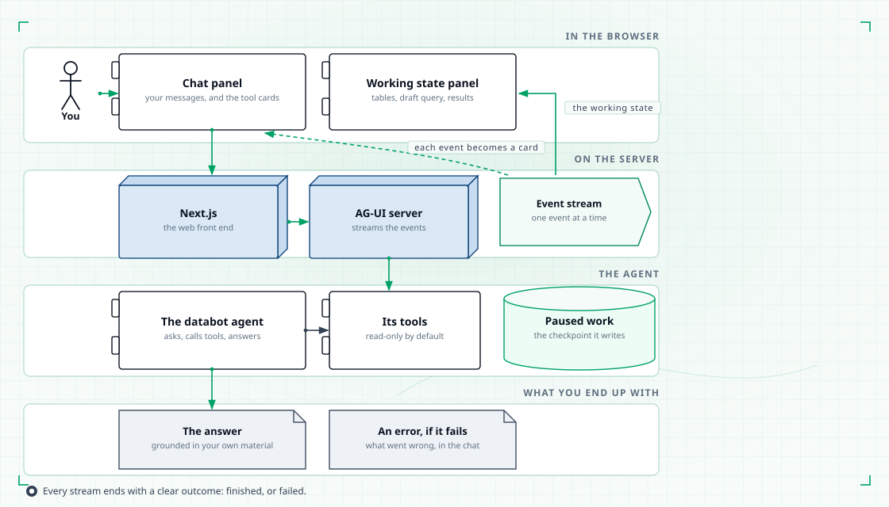
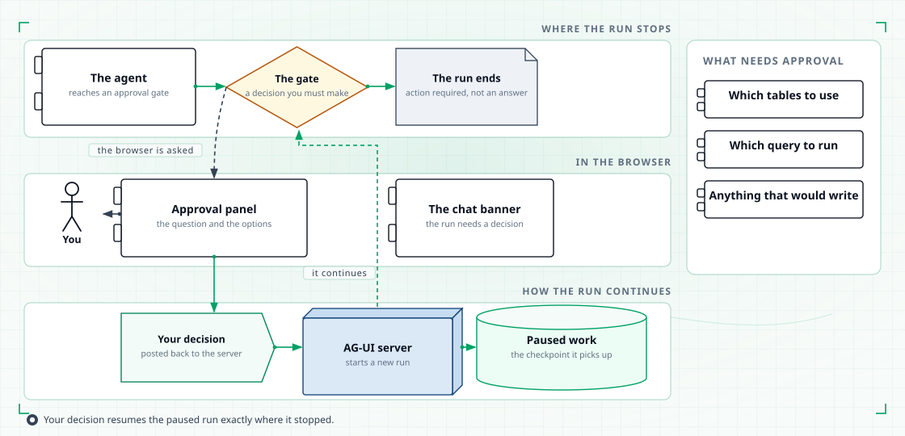

# Web UI

The browser shows the same platform as the terminal. The same specialists, the same
tools, the same approval gates. The difference is that you watch the work happen as it
happens.

## What the browser gives you

- **A chat that updates while the agent works.** You see the reasoning and the tool
  calls arrive as they run, not a blank screen until the end.
- **Tool calls as cards.** Each tool call appears in the chat with what it did and
  what came back, so you can see which table was picked and which query was drafted.
- **A panel for the working state.** The tables under consideration, the drafted
  query and the results sit beside the chat.
- **Approvals in the chat.** When something needs your decision, the chat shows a
  banner and the panel beside it shows the decision buttons.
- **Editable drafts.** You can change the selected tables or edit the drafted query
  before it runs.

## How a chat turn streams

<figure class="tp-diagram">
  
  <figcaption>Streaming events turn tool calls into cards in the chat.</figcaption>
</figure>

Your message becomes one streaming request. The platform sends back events as it
works: the run has started, a tool is calling, the tool finished, the working state
changed, the run is over. The browser turns each of those into something in the chat —
a card for a tool call, an updated panel for the state.

Every stream ends with a clear outcome, either finished or failed. The chat never
hangs on a half-closed stream, and a failure tells you what went wrong instead of
leaving you guessing.

## How approvals work in the browser

<figure class="tp-diagram">
  
  <figcaption>Your decision in the browser resumes the paused run.</figcaption>
</figure>

When the agent reaches a gate, it pauses and the run ends with an "action required"
outcome rather than a final answer. The chat shows a banner; the panel shows the
question, the options and any draft involved.

You pick a decision — approve, deny with comments, or run as a dry run — and add a
comment if you want. Your decision resumes the paused run exactly where it stopped,
and the rest of the work streams as it did before.

The same gates apply as in the terminal. Which tables to use, which query to run, and
anything that would write. A denial with comments is not a dead end: your comments go
back to the same stage, which tries again with them.

## How editing a draft works

Editing is not a chat message. When you change the selected tables or edit the drafted
query, the change is written straight into the paused work, and the panel shows what
you changed. When you then approve, you are approving what you edited.

Only the drafts that belong to the current stage can be edited. If you try to change
something the current stage does not own, the platform refuses and says why.

## The browser is a client of the same platform

The web UI is a client of the same agent workflow the terminal drives. The browser
does not run its own agents and does not have its own rules about what may run. An
approval in the browser and an approval in the terminal are the same decision, and a
conversation in the browser is stored in the same local place as a conversation in the
terminal.

Each chat is one conversation with its own identity, so several can be open at once.
Starting a new chat gives you a new one; the old one keeps its state.

## Running it

The web UI needs the platform's server and the browser front end. The front end
dependencies are installed once, with `cd frontend && npm install`. Then start both
with `./scripts/dev.sh start`.

Open http://localhost:3000. `./scripts/dev.sh status` checks that both are up, and
`./scripts/dev.sh stop` stops them. See [Getting started](getting-started.md) for the
credentials the platform needs before the first question.

## When something goes wrong

| What you see | What it means |
|---|---|
| The chat shows a runtime error | The run failed. The reason is in the server log, under the run's name |
| The chat shows an incomplete stream | The run ended without a clear outcome. Check the server log for that run |
| The panel says there is no active thread | The panel was opened before the first message. Send one first |
| The panel refuses an edit | The current stage does not own that draft |
| The approval panel never appears | The run stopped at a point that was not a gate, or the request never reached the server |
| Nothing loads in the browser | The server is not running, or the browser is calling the server directly instead of going through the web front end |
